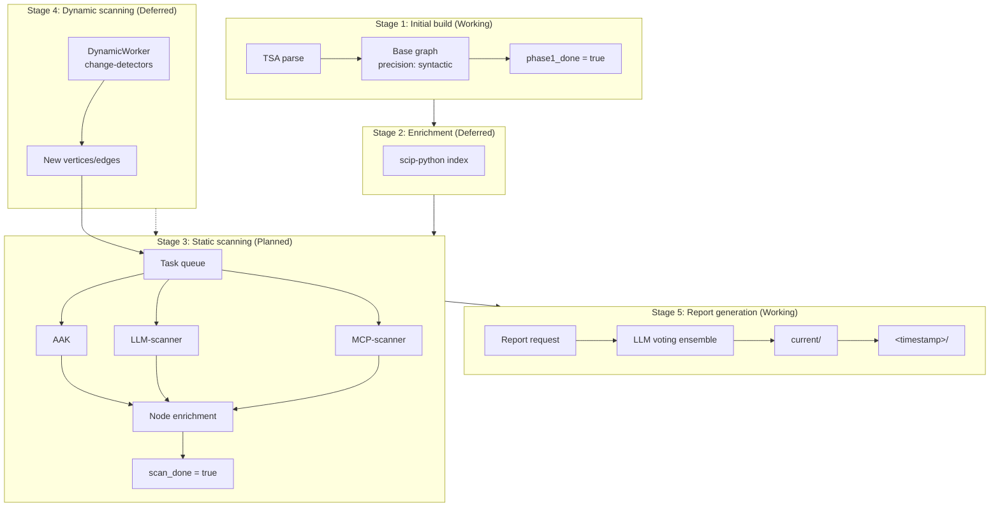

# ADR-0003: Graph Formation Cycle

**Status:** Accepted
**Date:** 2026-10-12
**Context:** Phase 0 → Phase 1 → Phase 2 → Phase 3

---

## Context

AICorellator builds a graph of AI tool interactions. The lifecycle has five stages, but only some are implemented. This ADR records the full intended cycle and explicitly marks the implementation status of each stage.

Key requirement: **the graph must be built fast** (TSA runs in seconds to minutes), but **enriched gradually** (SCIP requires toolchains, scanners take time). The most expensive stage must not block the pipeline.

---

## Considered Options

### Option A: Sequential pipeline

TSA → SCIP → scanners → dynamics → report. Each stage waits for the previous one to finish.

**Downside:** if SCIP is unavailable, the pipeline is blocked. If scanners run for 20 minutes, the graph is not updated for that entire time.

### Option B: Asynchronous pipeline with readiness flags

TSA → graph available. SCIP runs conditionally. Scanners — in a queue. Dynamics — separate workers.

**Advantage:** the graph is available immediately after TSA. Enrichment — as it becomes ready. Report — on request.

---

## Decision

**Adopt an asynchronous cycle with five stages and readiness flags.**

Each stage is marked with its implementation status:

- **Working** — implemented and used.
- **Planned** — not yet implemented, design ready.
- **Deferred** — interface reserved, implementation postponed.

---

## Stage 1: Initial build (TSA) — Working

**What:** TSA parses the source directory → base graph.

**Speed:** seconds to minutes.

**Result:** graph with nodes and edges, `precision: "syntactic"`.

**Flag:** `phase1_done = true`.

**Trigger:** immediately after completion.

**Note:** the `report --fast` trigger described in early drafts is deferred. `phase1_done` currently only signals "the graph exists, Phase 3 can run."

---

## Stage 2: Enrichment (SCIP, conditional) — Deferred

**What:** if the SCIP indexer's preconditions are met (Python 3.10+, Node 16+, activated venv) → `scip-python index .` → parse `.scip` → upgrade edges to `precision: "compiler-verified"`.

**Condition:** `scip-python` requires Node v16 or later and an activated virtual environment [^1].

**Status:** deferred. There is no SCIP worker in the codebase. There is no `scip_done` / `scip_skipped` flag in `schema.sql`.

**When implemented:** add the worker, add the flags to the `state` key set, update this ADR.

---

## Stage 3: Static scanning (queue) — Planned

**What:** a task queue over graph vertices. Workers:

| Scanner | What it scans | What it produces |
|---|---|---|
| AAK | MCP servers, tools, configs | taint findings, MCP config, IPI payloads |
| LLM-scanner | LLM endpoints, configs | model, provider, endpoint |
| MCP-scanner | MCP servers | tool schema, capabilities |

**Asynchrony:** scanners run in parallel. Each scanner takes its vertex (or vertex kind), enriches the node.

**Counter:** `static.active_count` — drops to 0 → `scan_done = true`.

**Status:** planned. The schema (`task_state` table, `scan_done` key) exists. The queue and workers are not implemented.

---

## Stage 4: Dynamic scanning — Deferred

**What:** dynamic workers (change-detectors) — detection of runtime changes. Example: an OSSEC agent inside the container tracks file changes and forwards events to a server [^2]. Or Docker diff to detect changes in running containers [^3].

**Trigger:** when AI activity is detected (new MCP server, new tool, changed config) → invoke static scanners for new vertices.

**Status:** deferred. The `DynamicWorker` interface is reserved; there are no implementations.

**Counter:** `dynamic.last_completed_at` — does not block `scan_done`, but must complete at least one cycle.

---

## Stage 5: Report generation — Working

**What:** LLM-ensemble analysis of the graph → `current/` bundle.

**Trigger:** on request only. Long (20–30 minutes), expensive.

**Architecture:** the LLM-ensemble analysis is specified in ADR-0005 and ADR-0006.

**Current implementation:** `render_report` produces Markdown. The bundle contains `report.md` and `chains.json`. The `--fast` / `--full` tiers are deferred.

**Archival:** `current/` → `<timestamp>/` on generating a new report.

---

## Readiness Flags

| Flag | Status | Meaning |
|---|---|---|
| `phase1_done` | Working | Graph built (Stage 1 complete) |
| `scan_done` | Reserved | All static workers done (Stage 3 complete) |
| `report_fresh` | Reserved | `current/` is up to date with the graph |
| `dynamic_enabled` | Reserved | Dynamic workers enabled |

**Working** flags are set and read by the code. **Reserved** flags are present in `schema.sql` and `state.py` but not used by any logic. They exist so that Stages 3–4 can be plugged in without a schema change.

---

## Diagram

---

## Consequences

### Positive

1. **Graph is available immediately.** TSA runs fast, `phase1_done` is set in seconds to minutes.
2. **SCIP does not block.** If there are no toolchains — the graph stays `syntactic`, the pipeline continues.
3. **Scanners are async.** Enrichment proceeds in parallel, does not block other stages.
4. **Dynamics — an option.** The interface is reserved, the implementation is deferred.
5. **Report — on request.** It does not burn resources automatically.

### Negative

1. **Coordination complexity.** Five stages, flags, counters — an orchestrator is needed.
2. **SCIP requires toolchains.** In an arbitrary container it may not run — the graph stays less precise.
3. **Dynamics not implemented.** Rug pull, dynamic tool injection — outside the visibility zone in the base version.

### Neutral

1. **`precision` as an edge attribute.** LLM analysis accounts for it: `compiler-verified` → higher chain confidence.
2. **Content hash for staleness.** Nodes with a changed hash → `confidence` is reset, a re-scan is required.
3. **Reserved flags** exist in schema but are not read by logic. This allows Stages 3–4 to be plugged in without schema changes.

---

## Deferred

1. **SCIP worker (Stage 2).** Not implemented. Flags `scip_done` / `scip_skipped` do not exist in the schema.
2. **Static scanner queue (Stage 3).** Not implemented. Schema and flags reserved.
3. **DynamicWorker implementations (Stage 4).** File watcher, Docker diff, OSSEC integration.
4. **`--fast` / `--full` report tiers.** Only a single Markdown report is implemented.
5. **Automatic report generation.** On request only.

---

## References

[^1]: `scip-python` prerequisites — Node.js v16 or later and an activated virtual environment.
[^2]: OSSEC — an open-source HIDS; an agent inside the container can track file changes and forward events to a server.
[^3]: Docker diff — comparing container filesystem state to detect changes in running containers.

---

## Decision Made

**Graph formation cycle:**

| Stage | Status | Flag |
|---|---|---|
| 1. TSA — base graph | Working | `phase1_done` |
| 2. SCIP — edge upgrade | Deferred | — |
| 3. Scanner queue — enrichment | Planned | `scan_done` (reserved) |
| 4. Dynamics — new vertices | Deferred | `dynamic_enabled` (reserved) |
| 5. Report — LLM analysis → `current/` | Working | `report_fresh` (reserved) |