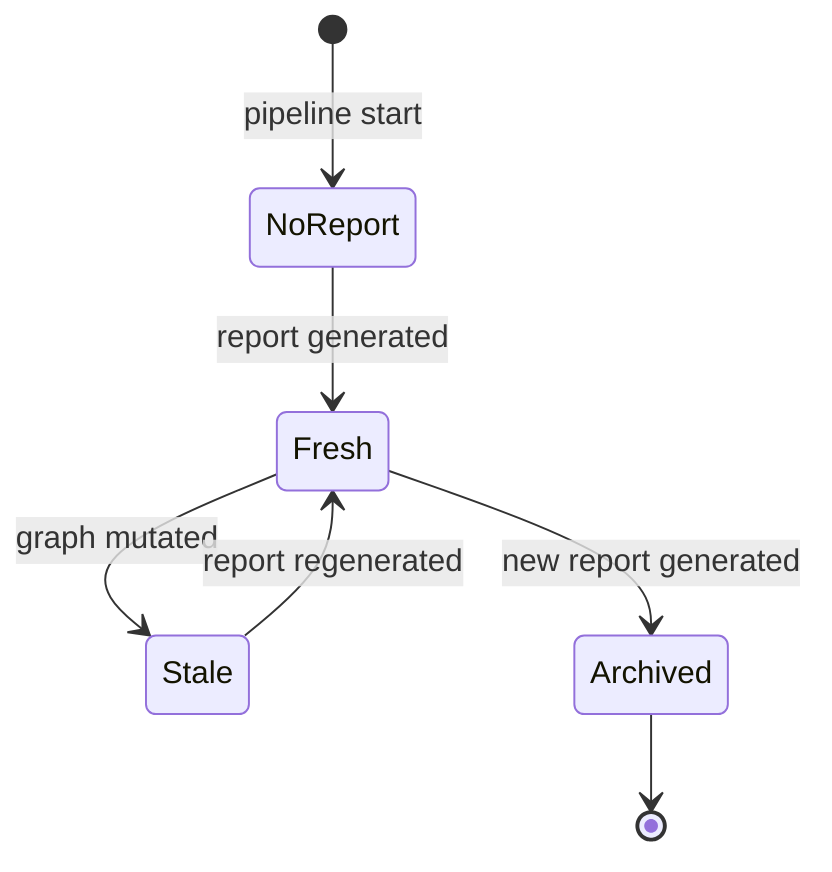

# ADR-0004: Report Generation

**Status:** Proposed
**Date:** 2026-10-12
**Context:** Markdown working; SARIF, JSON, and report tiers deferred

---

## Context

AICorellator builds a live graph of AI infrastructure and enriches it with scanner findings. The final step is LLM-ensemble analysis of the graph and publication of the report for the analyst.

Key requirements:

1. **The report is not automatic.** Generation is long (20–30 minutes for a full run with 3–4 LLMs and a judge) and expensive in resources.
2. **Two readiness tiers** (deferred): `report --fast` after `phase1_done` (base graph), `report --full` after `scan_done` (enriched graph).
3. **Archival:** `current/` → `<timestamp>/` on generating a new report.
4. **Freshness flag:** `report_fresh = false` on graph mutation.
5. **Format:** a bundle directory holding `report.md`, and (planned) `report.json`, `report.sarif`, `assets/`.

---

## Considered Options

### Option A: Automatic generation on graph mutation

**Approach:** on every graph change (new node, new edge, attribute change), LLM analysis and report regeneration are triggered.

**Downsides:**

- **Expensive.** Every mutation → 20–30 minutes of LLM work.
- **Meaningless.** An analyst cannot keep up with reports generated every few minutes.
- **Resources.** The LLM ensemble burns energy continuously.

**Precedent:** AppScan has a `report` command that loads a given scan and generates the report on request, not automatically on every change [^1].

### Option B: On-request generation with a freshness flag

**Approach:** the report is generated only on explicit request. `report_fresh` shows whether `current/` is up to date with the current graph. On graph mutation, `report_fresh = false`, but the report is not regenerated automatically.

**Advantages:**

- **Cost control.** The analyst decides when to spend LLM work.
- **Two tiers (deferred).** `--fast` for a quick check, `--full` for a deep audit.
- **Archival.** Each report is saved with a timestamp; the history is available.

### Option C: Hybrid — fast report automatic, full report on request

**Approach:** `report --fast` is generated automatically after `phase1_done`. `report --full` — on request only.

**Downside:** even `--fast` with a single LLM can take minutes. In continuous mode it is still expensive.

---

## Decision

**Adopt Option B: on-request generation with a freshness flag.**

### Lifecycle



| State | Condition | Action |
|---|---|---|
| `NoReport` | Report has not been generated | `report` command available |
| `Fresh` | `report_fresh = true` | `current/` is up to date |
| `Stale` | `report_fresh = false` | Graph changed, report is outdated |
| `Archived` | New report generated | Old `current/` → `<timestamp>/` |

### Triggers

| Event | What happens |
|---|---|
| `phase1_done = true` | Report generation is possible (base graph) |
| `scan_done = true` | Report generation is possible (enriched graph) |
| `report` request | Check flags → LLM analysis → `current/` → archive old |
| Graph mutation | `report_fresh = false` (report is not regenerated automatically) |

### Output Formats

| Format | Status | Purpose |
|---|---|---|
| **Markdown** | Working | Primary human-readable report |
| **JSON** | Deferred | Machine-readable output for integrations |
| **SARIF** | Deferred | GitHub / GitLab Security Dashboard [^2] |

### Bundle Layout

```
current/
├── report.md
└── chains.json
```

Planned additions: `report.json`, `report.sarif`, `assets/`.

### Report Structure

The Markdown report contains:

1. **Header** — host, timestamp.
2. **Summary** — node, edge, chain counts; by kind; by verdict.
3. **Nodes by kind** — table.
4. **Edges by kind** — table.
5. **Evaluated chains** — grouped by entry point, with verdict, confidence, reasoning.

Candidate chains (Phase 1 enumeration) are shown only when no evaluated chains exist.

---

## Consequences

### Positive

1. **Cost control.** LLM ensemble runs only on request.
2. **Two tiers (deferred).** Fast for quick checks, full for deep audits.
3. **Archival.** Report history is available in `<timestamp>/`.
4. **Freshness flag.** The analyst sees when `current/` is outdated.

### Negative

1. **Manual trigger.** The analyst must remember to regenerate.
2. **Delay.** A full run takes minutes — not suitable for urgent checks.
3. **Expensive.** LLM ensemble with judge burns resources.

### Neutral

1. **`report_fresh` is reserved.** Present in `schema.sql` and `state.py`, not yet read by logic.
2. **Bundle directory.** Archive via rename: `current/` → `<timestamp>/`.

---

## Deferred

1. **`--fast` / `--full` tiers.** Only a single report is generated.
2. **JSON and SARIF output.** Markdown only.
3. **Incremental reports.** Diff between two reports.
4. **Notifications.** Email / webhook on `report_fresh = false`.

---

## References

[^1]: AppScan `report` command — loads a scan and generates the report on request.
[^2]: SARIF output for the GitHub Security tab.

---

## Decision Made

**Report generation:**

1. **On request only.** No automatic generation.
2. **Lifecycle:** NoReport → Fresh → Stale → Archived.
3. **Archival:** `current/` → `<timestamp>/`.
4. **Freshness flag:** `report_fresh` (reserved).
5. **Formats:** Markdown working; JSON, SARIF deferred.
6. **Bundle:** `report.md` and `chains.json`.
7. **Tiers:** `--fast` / `--full` deferred.