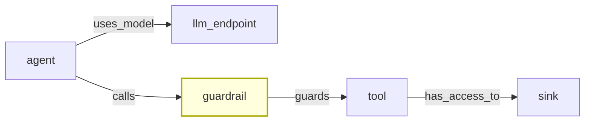

# ADR-0007: Guardrails as First-Class Graph Nodes

**Status:** Partially Accepted
**Detail:** Guardrail nodes done; `guards` edge and attributes deferred.
**Date:** 2026-10-12
**Context:** Phase 1 — Parsing and classification

---

## Context

While parsing FinBot CTF, a distinct component was found that the Phase 0 graph model did not account for: **guardrails**. These are policy enforcement points that sit between an agent and the tools it can call, filtering or modifying the interaction.

Without modeling guardrails as first-class nodes, chain semantics break in three ways:

1. A chain `agent → tool → sink` looks exploitable, but if a guardrail sits between agent and tool, the chain is blocked.
2. Bypassing a guardrail is a distinct attack step that the graph cannot represent.
3. Phase 3 (LLM chain evaluation) cannot judge exploitability if it does not see the enforcement layer.

---

## Considered Options

### Option A: Model guardrails as `sink` nodes

Treat a guardrail as another kind of sink. Simple, no schema change.

**Rejected:** semantically wrong. A guardrail is not a dangerous action — it is a defensive control. Conflating them breaks chain semantics and misleads the LLM during evaluation.

### Option B: Model guardrails as `tool` nodes

Treat a guardrail as a tool with a filter attribute. No schema change.

**Rejected:** guardrails are not callable by the agent. They are infrastructure, not capability. This distinction matters for attack chain analysis.

### Option C: Add `guardrail` as a new node kind

Extend the schema. New kind, new edge kind, same table.

**Accepted.**

---

## Decision

**Add `guardrail` as an eighth node kind, and `guards` as a fifth stored edge kind.**

### Node kind

| Kind | Description |
|---|---|
| `guardrail` | A policy enforcement point between agent and tool |

### Edge kind

| Kind | Description |
|---|---|
| `guards` | Guardrail protects an agent or a tool |

### Guardrail attributes

| Attribute | Values | Description |
|---|---|---|
| `policy` | `prompt_injection`, `pii`, `tool_allowlist`, `rate_limit`, `unknown` | What the guardrail filters |
| `enforcement_point` | `pre_tool_call`, `post_llm_response`, `pre_agent_step`, `unknown` | Where it sits in the flow |
| `source_file` | path | Where it was found |

### Derived edges (NOT stored)

| Derived kind | Meaning |
|---|---|
| `bypassed_by` | Reverse of `guards` — a tool or agent that bypasses the guardrail |

---

## Diagram

---

## Implementation Status

**As of 2026-10-13:**

| Feature | Status |
|---|---|
| `guardrail` node kind | Implemented. The classifier emits `guardrail` for classes in `guardrails/**` with names containing `Guardrail`, `Guard`, or `Hook`. |
| `guards` edge kind | Registered in the schema and in the edge kinds registry. **Not emitted by any component.** |
| Guardrail attributes (`policy`, `enforcement_point`) | **Not populated.** Nodes exist without these attributes. |
| `bypassed_by` derived edge | Not implemented. |

The node kind is in place, so guardrail components appear in the graph. Chain enumeration does not yet treat them as blocks or bypasses — chains pass through guardrails without adjustment. This is a known gap; it does not break chains, it only fails to reflect that a guardrail might stop one.

Deferred until Phase 2, when the untrusted-source work (ADR-0010) gives a natural context for `policy` and `enforcement_point` attributes.

---

## Consequences

### Positive

1. Guardrails appear in the graph as distinct entities.
2. Chain enumeration can, in principle, treat them as blockers.
3. The LLM in Phase 3 can reason about the enforcement layer.
4. The `guards` edge kind is reserved for future use without a schema change.

### Negative

1. Guardrail nodes currently exist without attributes. They are inert.
2. Chains do not yet account for guardrails. This is a false-negative risk: a chain that looks exploitable may in reality be blocked.
3. Populating guardrail attributes requires source-level analysis of what the guardrail actually filters — a separate task.

### Neutral

1. `guardrail` is a new node kind. The database is recreated per scan (ADR-0003), so no migration is required.
2. The `guards` edge kind is registered but unused. No production code emits it.

---

## Deferred

1. **`guards` edge emission.** Requires detecting guardrail-to-agent or guardrail-to-tool relationships. Not implemented.
2. **Guardrail attributes.** `policy` and `enforcement_point` require parsing the guardrail's body to understand what it filters. Not implemented.
3. **`bypassed_by` derived edge.** Requires the `guards` edge first.
4. **Guardrail-aware chain evaluation.** The LLM ensemble must receive guardrail information and reason about whether a chain is blocked. Deferred to Phase 3.

---

## References

- ADR-0009 — Capabilities on nodes and edges
- ADR-0010 — Multi-chain groups and untrusted channels

---

## Decision

1. `guardrail` is an eighth node kind.
2. `guards` is a fifth stored edge kind.
3. Guardrail attributes (`policy`, `enforcement_point`) are defined.
4. `bypassed_by` is a derived edge, not stored.
5. **Implementation status:** node kind done; edge and attributes deferred.