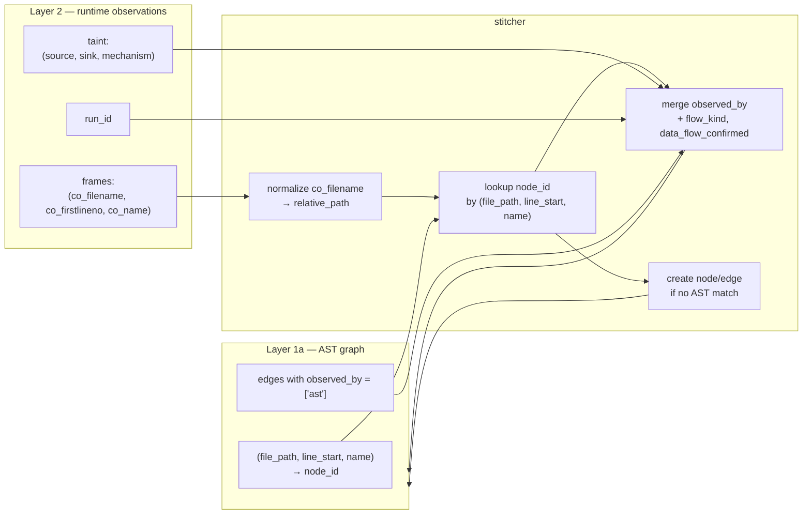

# ADR-0017: Layer 1 / Layer 2 Graph Stitching

**Status:** Proposed
**Date:** 2026-10-25
**Context:** Layer 2 (runtime), post-ADR-0016

---

## Context

ADR-0016 introduced `observed_by` as a JSON array on every node and
edge, and established that Layer 1a (AST) writes `["ast"]` while
Layer 2 (runtime) adds `"runtime"`. It did not specify **how** Layer 2
finds the AST node or edge that a runtime observation corresponds to.

That mapping is not trivial, and it is worth an ADR because:

1. **The two layers see different things.** AST sees all defined
   functions, all written calls, all declared sinks. Runtime sees only
   what executed: functions called, values flowed, sinks reached. The
   intersection is smaller than either layer alone, and the graph must
   represent the difference — not paper over it.

2. **The identity keys are different.** AST node identity is
   `sha256(kind + file_path + name + host_id)` — a content hash. Runtime
   identity is a Python frame: `(co_filename, co_firstlineno, co_name)`.
   There is no shared ID; there is a shared *position*.

3. **Stitching is not "join and done".** A runtime observation that
   reaches a sink may not correspond to any AST edge — the AST may not
   have seen the call (dynamic dispatch, `getattr`, `**kwargs`). An AST
   edge may never be observed — the test suite did not cover it. Both
   are facts about the system, and both must be representable.

4. **Multiple runtime runs are possible.** A test suite run, a manual
   reproduction, a fuzzing campaign — each produces observations. The
   graph must distinguish "observed by run A" from "observed by run B"
   when the analyst asks, and must merge them when the analyst does not.

The question this ADR answers is: **given a runtime observation, which
AST node or edge does it confirm, and how is that recorded?**

---

## Considered Options

### Option A: Match by name only

Runtime sees `co_name = "delete_file"`. AST has a node named
`delete_file`. Match them.

**Rejected.** Names are not unique. `delete_file` can be defined in
two classes, in two files, on the same host. `toggle_enabled` at
`finbot/core/data/repositories.py:664` and `:1426` is exactly this
case — the existing AST code already had a bug from name-only
matching, fixed in 1.2a.3f by keying on `(name, line_start)`. Runtime
must not reintroduce the same bug.

### Option B: Match by `(file_path, name)` only

Add the file. `("repositories.py", "delete_file")`. Still not unique
— two classes in one file can define the same method name.

**Rejected.** Same failure mode as Option A, one level finer. The
existing AST fix keyed on position for this exact reason.

### Option C: Match by `(file_path, line_start, name)`

Runtime frame gives `(co_filename, co_firstlineno, co_name)`. AST
symbol (`TSASymbol`) gives `(file_path, line_start, name)`.
`co_filename` is an absolute path; `file_path` is relative to the
target root; the mapping is `co_filename → relative_path` via
`Target.root`. The three-tuple is unique within a scan (a name can be
defined twice, but not at the same line).

**Accepted.**

### Option D: Match by source hash of the body

Compute a hash of the function body AST, and a hash of the runtime
code object's `co_code`. Match by hash.

**Rejected.** `co_code` is bytecode, not source; the two hashes are
not comparable. `co_consts` and `co_names` could approximate, but
they are not stable across Python versions and do not survive
refactoring. The three-tuple is stable and cheap.

---

## Decision

**Adopt Option C.** The stitching key is
`(file_path, line_start, name)` — the only identity both layers share.

### The key

| Layer | Provides |
|---|---|
| AST | `TSASymbol.file_path` (relative to `Target.root`), `TSASymbol.line_start`, `TSASymbol.name` |
| Runtime | `frame.f_code.co_filename` (absolute), `frame.f_code.co_firstlineno`, `frame.f_code.co_name` |

The stitcher computes:

```
relative_path = os.path.relpath(co_filename, target_root)
key = (relative_path, co_firstlineno, co_name)
```

and looks up the AST node by the same key. Both keys are computed
once and stored in a `(file_path, line_start, name) → node_id` index
on the AST side, and in a `(file_path, line_start, name) → [observations]`
index on the runtime side.

**Why `co_firstlineno` and not `frame.f_lineno`:** `f_lineno` is the
line currently executing, which changes per statement. `co_firstlineno`
is the line where the function starts — stable, and equal to
`TSASymbol.line_start` when TSA reports a function definition. A
decorator shifts `co_firstlineno` to the first decorator line, not the
`def` line; the stitcher accounts for this by trying `line_start`,
`line_start - 1`, `line_start - 2`, ... up to a small bound
(`MAX_DECORATOR_LINES = 5`), taking the first match. A function with
more than five decorator lines is a construction error, not a
matching failure.

### What gets stitched

A runtime observation produces three kinds of facts:

1. **Node observed.** A function was executed. The AST node for that
   function gains `"runtime"` in `observed_by`. If the AST has no node
   at that key (a function the AST did not classify, or a dynamically
   defined function), the runtime layer may **create** a node with
   `observed_by = ["runtime"]` and `kind = "unknown"`. This is rare
   and is recorded explicitly, not silently.

2. **Edge observed.** A function called another function. The AST
   edge between them (if it exists) gains `"runtime"` in
   `observed_by`. If the AST has no edge (dynamic dispatch), the
   runtime layer creates one — see *No new edge kind* below.

3. **Flow observed.** Tainted data from a source reached a sink. The
   AST edge between the source and the sink (if it exists) gains
   `"runtime"` in `observed_by`, and `flow_kind` is set to `"data"`,
   and `data_flow_confirmed` is set to the mechanism
   (`parameter_match` / `local_var_match` / `call_result_match`). If
   the AST has no edge, the runtime layer creates one — see below.

The three are independent. A function can be observed without its
calls being observed (a leaf function that ran). A call can be
observed without data flowing (a call with constant arguments). Data
can flow without the AST having an edge (dynamic dispatch through
`getattr`).

### No new edge kind

The stitcher does **not** introduce a new edge kind for
runtime-observed calls. `has_access_to` already means "X can reach Y";
a runtime observation that X reached Y is the same edge with
`observed_by = ["runtime"]` (or `["ast", "runtime"]` when the AST saw
it too).

This is deliberate, and it follows from two invariants:

- **One edge per relationship.** `schema.sql` has a `UNIQUE INDEX` on
  `(source_id, target_id, kind, host_id)`. Two edges with the same
  source, target, kind, and host are a construction bug. If the AST
  saw `uses_tool` and runtime saw the same call, there is one edge
  with `observed_by = ["ast", "runtime"]` — not two edges with two
  kinds.

- **Kind is a fact about the relationship; `observed_by` is a fact
  about who confirmed it.** Mixing them is the same mistake ADR-0016
  fixed for `flow_kind` vs `data_flow_confirmed`. A new kind for
  runtime-observed calls would conflate "what kind of edge is this"
  with "who saw it".

**When the AST has no edge**, the stitcher creates one with:

- `kind = "has_access_to"` — the most general kind. It means "X can
  reach Y" and makes no claim about what kind of call it was. The
  AST did not classify it; the stitcher does not invent a
  classification.
- `observed_by = ["runtime", "runtime:<run_id>"]`.
- `flow_kind = "control"` — a call is not a flow. If the observation
  is a data flow (case 3), `flow_kind = "data"` and
  `data_flow_confirmed` is set instead.
- `data_flow_confirmed = NULL` for case 2 (a call); set to the
  mechanism for case 3 (a flow).

**When the AST has an edge**, the stitcher **does not change its
kind**. An AST `uses_tool` edge observed at runtime stays `uses_tool`
with `observed_by = ["ast", "runtime"]`. The stitcher adds
confirmations; it does not reclassify.

### Multiple runtime runs

A run has an ID (`run_id`, from the test command and a timestamp).
Observations from run `run_id` add `"runtime:<run_id>"` to
`observed_by`, and also add the bare `"runtime"` — so a query for
`"runtime" in observed_by` matches any run, and a query for a
specific run matches only that run.

The stitcher does not merge runs into one. If run A observed a call
and run B did not, the edge has `observed_by = ["ast",
"runtime:run_a"]` — the absence in run B is not recorded, because
absence is not evidence (the test may not have covered the path).
This is deliberate: the graph records what was observed, not what was
not.

### Idempotence

Stitching the same run twice produces the same graph. `observed_by`
is a set union, and the stitcher checks the run ID before adding it.
Running the stitcher on a graph that already has `"runtime:run_a"`
does not duplicate it. This is what makes a re-run of `run_eval.py`
after a runtime scan safe.

### What the stitcher does not do

- **It does not re-run the AST analysis.** It reads the existing
  graph, matches keys, and writes `observed_by` additions. If the
  AST graph has no node at a key, the stitcher creates one (with
  `kind = "unknown"`), but it does not re-classify the source.
- **It does not infer data flow from calls.** A call observed at
  runtime is `flow_kind = "control"`. Data flow requires taint
  tracking; the stitcher records what the tracker observed, not what
  it could infer.
- **It does not delete AST edges.** An AST edge that runtime never
  observed is still in the graph, with `observed_by = ["ast"]`. The
  analyst sees both: "the AST thinks this path exists" and "runtime
  never saw it". Both are facts.
- **It does not change the kind of an existing AST edge.** An AST
  `uses_tool` edge stays `uses_tool`; the stitcher adds
  `"runtime"` to `observed_by`.

---

## The stitching pipeline



The stitcher is the only component that writes `observed_by` additions
after Layer 1a. It runs once per runtime run, after the run's
observations are collected, before `run_eval.py` is invoked.

---

## Consequences

### Positive

1. **The graph records both layers honestly.** `observed_by = ["ast"]`
   means "the AST thinks so". `observed_by = ["ast", "runtime:run_a"]`
   means "the AST thinks so, and run A saw it". Both are visible.
2. **The key is stable.** `(file_path, line_start, name)` survives
   refactoring better than a name alone, and is available in both
   layers without changes to TSA or to Python's frame API.
3. **Multiple runs are distinguishable.** A specific run can be
   queried; absence of a run is not recorded as evidence.
4. **Dynamic dispatch is representable.** A call the AST did not see
   creates a `has_access_to` edge with `observed_by = ["runtime"]`.
   The graph does not pretend the AST saw it, and it does not invent
   a classification.
5. **The stitcher is idempotent.** A re-run does not duplicate
   observations.
6. **No new edge kind.** The schema, `patterns.EDGE_KINDS`,
   `graph.models.VALID_EDGE_KINDS`, and `patterns.CONTROL_EDGE_KINDS`
   are unchanged.

### Negative

1. **The key has a decorator caveat.** `co_firstlineno` points to the
   first decorator line, not the `def` line. The stitcher tries a
   small window. A function with more than `MAX_DECORATOR_LINES`
   decorators (5) is not stitched. This is rare and is logged.
2. **`kind = "unknown"` nodes are possible.** A runtime-observed
   function the AST did not classify produces a node with
   `kind = "unknown"`. The prompt and the report must handle it.
3. **The stitcher writes to the graph.** Layer 1a is read-only for
   the evaluator (ADR-0006); the stitcher is a writer. This is a new
   writer, and it must be transactional like `write_graph`.
4. **A runtime-observed call with no AST edge is `has_access_to`,
   not a more specific kind.** This is a deliberate loss of
   specificity: the AST did not classify the call, and the stitcher
   does not guess. The analyst sees `observed_by = ["runtime"]` and
   knows the AST did not see it.

### Neutral

1. **The stitcher is Python-only.** Other languages will have their
   own stitchers with their own keys (`(file, line, method)` for
   Java stack traces, `(binary, address)` for Go). The ADR fixes the
   key for Python; it does not generalize.
2. **The stitcher does not change `data_edges_only`.** The filter
   already keys on `"runtime" in observed_by`; the stitcher is what
   makes that true.
3. **`observed_by` on edges and nodes is a set union.** Merging is
   the repository's existing `upsert` semantics; no new merge logic.

---

## Deferred

1. **Runtime taint tracking itself.** ADR-0017 specifies the
   stitcher, not the tracker. `runtime/python/taint_tracker.py` is
   separate work.
2. **Non-Python stitchers.** Java, Go, Rust — each will need its own
   key and its own stitcher. Deferred until Python works.
3. **Cross-run flow analysis.** "Run A observed the write, run B
   observed the read, together they form a group." This is the
   runtime analogue of `chain_groups`, and it needs a design of its
   own. Deferred.
4. **Stitching audit.** A report that shows, per node and edge,
   which runs observed it. Deferred until the stitcher produces
   enough data to make the report worth writing.
5. **Observation weighting.** An edge observed by 100 runs is
   stronger than one observed by 1. ADR-0017 does not weight
   observations; it records them. Weighting is a prompt-time
   decision, deferred.

---

## References

- ADR-0006 — Two-layer chain evaluation. The stitcher runs between
  Layer 1 and Layer 3.
- ADR-0016 — Control-only AST layer and `observed_by`. The schema
  this ADR writes into.
- `Documentation/Architecture/OVERVIEW.md` — the four layers, with
  Layer 2 marked as roadmap.
- `Documentation/BACKLOG.md` — the items this ADR defers.

---

## Decision

1. The stitching key is `(file_path, line_start, name)` —
   `relative_path` from `co_filename` via `Target.root`,
   `co_firstlineno` (with a decorator window of 5), `co_name`.
2. A runtime observation adds `"runtime"` and `"runtime:<run_id>"` to
   `observed_by` on the matching node and edge.
3. If no AST match exists, the stitcher creates a node
   (`kind = "unknown"`) or an edge (`kind = "has_access_to"`,
   `flow_kind = "control"`, `data_flow_confirmed = NULL`).
4. The stitcher **does not** change the kind of an existing AST edge.
   An AST `uses_tool` edge observed at runtime stays `uses_tool`
   with `observed_by = ["ast", "runtime"]`.
5. No new edge kind is introduced. `has_access_to` already means
   "X can reach Y"; a runtime observation that X reached Y is the
   same edge with `observed_by = ["runtime"]`.
6. Multiple runs are distinguished by `"runtime:<run_id>"`. Absence
   of a run is not recorded as evidence.
7. The stitcher is idempotent: stitching the same run twice produces
   the same graph.
8. The stitcher does not re-run the AST analysis, does not infer
   data flow from calls, and does not delete AST edges.