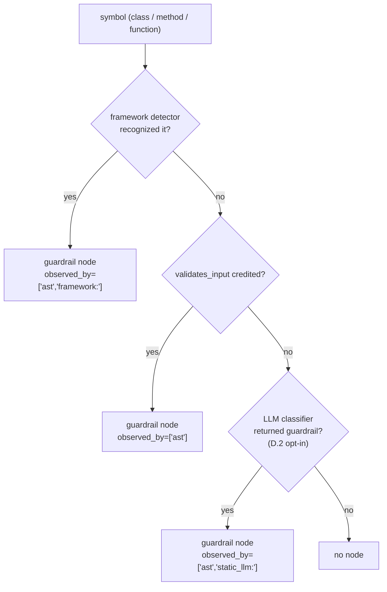

# ADR-0024: The `guardrail` node producer

**Status:** Accepted
**Date:** 2026-10-30
**Related:** ADR-0009 (capabilities from AST calls), ADR-0011 (framework detectors), ADR-0016 (control-only AST; class-A heuristics removed), ADR-0019 (guardrail emission and weighting), B.4a / B.4b / B.4-gap

---

## Context

ADR-0019 makes `guards` a structural edge (`guardrail → component`) and the payload a `guardrails` section the model weighs. B.4a (emission) and B.4b (weighting) ship and are correct. B.4-gap records the remaining hole: **no deterministic layer produces `guardrail` nodes**. ADR-0016 decision 7 removed the class-A heuristics (the `guardrails/` path rule, the `*Guardrail` class suffix), and `classify_class` / `classify_method` return `sink` / `agent` / `llm_endpoint` / `tool` and nothing else. The LLM classifier (D.2) can produce a `guardrail` node (its `KIND_ENUM` already names the kind), but D.2 is opt-in, off by default, and the fallback, not the primary.

The result on the four corpora: `guards = 0`. B.4a's emission and B.4b's weighting have nothing to link. The feature is correct and inert.

This ADR decides the **producer**: how a `guardrail` node is created, by which layers, in which order of precedence. It does **not** change ADR-0019 (emission, weighting, no filter, no exclusion) or ADR-0016 (control-only AST, no class-A name tables). It fills the gap those two left.

---

## Decision

### 1. Three producers, one precedence

A `guardrail` node is produced by **three layers**, in this order of precedence:

1. **Framework detector** (ADR-0011 route) — an SDK knows its own guardrail shape. Highest precedence: the detector's evidence is the strongest (the SDK's own convention).
2. **Capability** — `validates_input`, a **negative** capability (§2). Second: structural, deterministic, but an inference (a function that is called from an agent and carries no other capability is *probably* a guardrail, not certainly).
3. **LLM classifier** (D.2) — `guardrail` in `KIND_ENUM`; opt-in, off by default. Last: a fallback for projects no detector and no capability covers.

**Deterministic wins on conflict.** A detector node replaces a capability-derived node of the same `(name, source_file)` (the `DetectorMergeStage` rule, ADR-0011). A capability-derived node is not overwritten by a later LLM answer (D.2's "deterministic wins" rule, unchanged). An LLM answer fills only where neither a detector nor the capability saw the symbol.

**Three producers, three provenance values.** A `guardrail` node's `observed_by` records the producer: `["ast"]` for a capability-derived node (the AST is the evidence), `["ast", "framework:<name>"]` for a detector node, `["ast", "static_llm:<model>"]` for an LLM node (D.2's provenance, unchanged). The three are distinguishable; an analyst reading the graph can tell which layer named a guardrail.

### 2. Capability: `validates_input` (negative)

`validates_input` is a **negative** capability: a function or method **called from** an `agent` / `tool` / `entry_point` body **and carrying none of** `SINK_CAPABILITIES`, `AGENT_CAPABILITIES`, `LLM_ENDPOINT_CAPABILITIES`, `TOOL_CAPABILITIES`. Its body does not execute, write, send, call an LLM, or invoke a tool; it is called from a component that does, and it is not a component itself.

**Why a negative capability, not a name table.** ADR-0016 decision 7 forbids a table that grants a kind from a name (`validate_input`, `filter`, `policy` as literal names). A **negative** capability is structural: it is computed from the call graph (who calls whom) and the capability set (which the capability extractor already produces), not from a name. A function called from an agent whose body carries no capability is **structurally** a candidate for a guardrail — the call shape says "this is part of the agent's work, and it is not itself a component". The name is never read.

**The rule, in one place:**

- The function is called from the body of a node with kind `agent`, `tool`, or `entry_point` (the call graph, per-file `ast.Name` calls, the same the capability extractor and the normalizer use).
- The function's own capabilities are empty (no `SINK_CAPABILITIES`, `AGENT_CAPABILITIES`, `LLM_ENDPOINT_CAPABILITIES`, `TOOL_CAPABILITIES`). The function may have `reads_*` / `writes_*` capabilities only if those are not in `SINK_CAPABILITIES` — but a body that reads a file is already a sink candidate, so the practical case is "no capability".
- Then `validates_input` is credited; `classification.py` yields `guardrail`.

**The false positives the rule accepts.** `logger.info(text)` called from an agent body, with no capability, is a `validates_input` candidate. So is `print(text)`, `format(text)`, any helper. The capability is **weak**; the `guardrails` payload (ADR-0019 §2) is a **signal the model weighs**, not a filter; a spurious `guardrail` node is a spurious weak group the analyst sees and dismisses. The alternative — a name table — is ADR-0016's removal and stays removed. ADR-0009's "false positives accepted; the LLM filters" is the frame.

**Where the rule runs.** A new pass in the class / method node stages (the `ClassNodeStage` / `MethodNodeStage`'s output, or a post-pass) reads the call graph and the capability map and credits `validates_input` on the matching symbols. The exact stage is the implementation's; the ADR decides the rule. The `guardrail` kind is produced by `classification.py` from the capability, the same way `sink` / `agent` / `llm_endpoint` are produced from their capabilities.

**The `middleware` constructor is not a `validates_input` candidate.** A `Guard(...)` / `Middleware(...)` / `BaseCallbackHandler` subclass's **constructor** is called at setup, not per step; it is not "called from an agent body" in the chain's sense. A middleware is caught by the **detector** (§3), which knows the SDK's shape; the capability rule does not pretend to.

### 3. Framework detectors: one per SDK

A `guardrail` detector recognizes a known guardrail SDK's shape and emits `guardrail` nodes from that SDK's conventions. Four SDKs are in the initial plan; each is a separate implementation step:

- **Guardrails AI** — `Guard.from_pydantic(...)`, `Guard(...)`, `@guard` decorator, `guard.parse(...)`, `guard.validate(...)`. A `guardrail` node per `Guard(...)` construction; the class / function it wraps is the guarded component (a `guards` edge, B.4a, when it is recognized).
- **NeMo Guardrails** — `RailsConfig.from_path(...)`, `LLMRails(config)`, `rails.generate(...)`, `@action` (NeMo-specific). A `guardrail` node per `LLMRails(...)` construction; the `@action` functions it registers.
- **LangChain callbacks** — `BaseCallbackHandler` subclass, `on_llm_start` / `on_tool_start` / `on_agent_action` methods (the hook names are the SDK's own; the detector reads the SDK's class, not the project's). A `guardrail` node per handler subclass.
- **FastMCP middleware** — `@mcp.middleware` decorator, `Middleware(...)` base class, the SDK's own hook methods. A `guardrail` node per middleware.

**Per-SDK module, registry line.** The detector is a `FrameworkDetector` subclass in `framework_detectors/` (flat, like `langchain.py` / `fastmcp.py`), registered in `registry.py` (one line per detector). A user detector for a fifth SDK is a file plus a line — the ADR-0011 route, unchanged.

**The SDK's `guards` relationship.** A detector that recognizes a `Guard(...)` and the component it wraps has the evidence for a `guards` edge (ADR-0019 §1). The edge is emitted by B.4a's `guardrail_edges` stage **if** the detector's node and the wrapped component are both in the delta. The detector's job is the `guardrail` node; the `guards` edge is B.4a's, and the two agree by construction (a detector node is a `guardrail`; B.4a links it to the components it is visible from).

### 4. LLM classifier (D.2): `guardrail` in `KIND_ENUM`

D.2's `KIND_ENUM` already names `guardrail`; the classifier can return it. No change to D.2. The rule is D.2's:

- The classifier runs on symbols no deterministic layer classified, including symbols no detector and no capability named.
- A `guardrail` answer creates a `guardrail` node (`observed_by=["ast", "static_llm:<model>"]`, D.2's provenance).
- The LLM never overwrites a deterministic node (D.2's "deterministic wins").

**The classifier's limiters and `guardrail`.** D.2's three limiters are: `part_of_parent` → no node; method inside an agent-class → no node (capability to parent); tool inside an `mcp_server` without a decorator → `unverified_tool`. None of the three addresses `guardrail`: a guardrail is a top-level class or function (a `Guard` subclass, a `BaseCallbackHandler` subclass, a `@guard`-decorated function), and D.2's default answer for a class is a kind. A `guardrail` method inside a class is a `part_of_parent` answer (the class is the node), which is correct — the class is the guardrail. No new limiter is needed; D.2's existing rules cover the shape.

**D.2 is opt-in.** `mode: off` default; the fallback fills the gap only for an analyst who turned it on. This is the reason the capability and the detectors are the primary producers; D.2 is the last resort.

### 5. Precedence, in one place

**Detector > capability > LLM.** The three are distinguishable by `observed_by`. A conflict is resolved by the merge (detector replaces capability at the same `(name, source_file)`), and the LLM never overwrites either.

### 6. What the `guardrail` node becomes

A `guardrail` node is an **actor** (a defensive control), not a step in an attack path. It is a `guards` edge source (`guardrail → component`, B.4a), the payload's `guardrails` section (B.4b), and a **weak** signal the model weighs.

- **`flow_kind` of `guards`:** `structural` (ADR-0019 §1; ADR-0015 decision 5). `find_chains` does not traverse it.
- **No `data_flow_confirmed`** (ADR-0016 decision 3). A guardrail's presence is a declaration; it does not trace a value.
- **No exclusion, no marking** (ADR-0019 §2). The model weighs the guardrail; the chain is not excluded, not marked blocked.

**`guardrail` is a weak signal.** A capability-derived `guardrail` (a `logger.info` called from an agent) is the weakest. A detector-derived `guardrail` (Guardrails AI's `Guard(...)`) is the strongest. The `observed_by` says which; the payload's `guardrails` section names the source; the model weighs it with the rest of the chain's evidence (ADR-0019 §2's "signal, not filter").

### 7. What this ADR does not do

- **No `bypassed_by` edge.** ADR-0019 §4 deferred it; the reverse edge is a separate decision (which guardrail was bypassed by which component, on which chain).
- **No guardrail attributes.** `policy` / `enforcement_point` (BACKLOG D.6) are a separate decision; the node is created without them, and D.6 enriches the payload when it lands.
- **No change to ADR-0019's emission or weighting.** B.4a's `guardrail_edges` stage is unchanged; B.4b's payload section is unchanged. The producer fills the node set; the emission and weighting are as they are.
- **No change to ADR-0016.** No class-A name table is reintroduced. The capability is negative, the detector reads the SDK's own shape, the LLM reads the code.
- **No change to D.2.** `guardrail` is already in `KIND_ENUM`; the limiters already cover the shape (a method inside a class is `part_of_parent`; the class is the node).
- **No change to `find_chains`, `find_chain_groups`, the report.**

---

## Rationale

### Why three producers, not one

Each layer covers a different project shape:

- A project using **Guardrails AI / NeMo / LangChain callbacks / FastMCP middleware** has an SDK the detector recognizes. **Detector** is the strongest evidence (the SDK's own convention).
- A project with a **custom guardrail function** (`def validate_input(text)`) has no SDK. **Capability** is the only structural signal.
- A project with **a custom SDK** has neither. **LLM classifier** (opt-in) is the last resort.

**One producer** covers one shape. **Three** cover the space. The precedence makes the strongest producer win; the `observed_by` keeps them distinguishable.

### Why the capability is negative, not a name table

ADR-0016 decision 7 removed the class-A name tables. A `validates_input` capability that reads `validate_input` / `filter` / `policy` as literal names would be the same table in another shape. A **negative** capability — called from an agent body, no capability of its own — is structural: the call graph and the capability map are already produced by the deterministic layers, and the rule reads them, not names. The false positives (`logger.info`, `print`) are the price; the LLM's weighting is the filter (ADR-0009's "false positives accepted").

### Why the middleware is the detector's, not the capability's

A `Guard(...)` / `Middleware(...)` / `BaseCallbackHandler` subclass's **constructor** is called at setup, not per step. A `validates_input` rule that read the constructor as "called from an agent body" would be wrong (it is called at setup, not per request). A detector that knows the SDK's shape reads the SDK's own conventions; the capability's rule does not pretend to cover the middleware.

### Why D.2 stays unchanged

D.2 already names `guardrail` in `KIND_ENUM`; its limiters already cover the shape (a method inside a class is `part_of_parent`; the class is the node). The producer's LLM layer is D.2 as it is; the ADR does not edit it. `mode: off` default keeps D.2 opt-in; the capability and the detectors are the primary producers.

### Why one precedence, not three independent layers

Three independent layers would produce three nodes for the same symbol on a project that has both an SDK and a custom guardrail function — three `guardrail` nodes, three `guards` edges, three payload entries. The precedence (detector > capability > LLM) produces one node per symbol, with `observed_by` naming the producer. The merge (detector replaces capability) is ADR-0011's; the LLM's "deterministic wins" is D.2's; the ADR does not add a fourth rule.

### What "guardrail" is not

- **Not a sink.** A guardrail does not execute, write, send; it filters. The `validates_input` capability is not in `SINK_CAPABILITIES`; a `guardrail` node is not a chain endpoint.
- **Not a step in a path.** A `guards` edge is `structural`; `find_chains` does not traverse it.
- **Not a filter.** The payload's `guardrails` section is a signal; the model weighs it; the chain is not excluded, not marked blocked (ADR-0019 §2).

---

## Consequences

- **The producer fills the `guardrail` node set.** Capability (deterministic, structural, false positives accepted), detectors (per-SDK, strongest), LLM (D.2, opt-in, last resort). Precedence: detector > capability > LLM. `observed_by` names the producer.
- **B.4a's emission and B.4b's weighting become reachable.** On a project with any of the three shapes, `guardrail` nodes exist; `guards` edges are emitted; the payload gains the `guardrails` section; the model weighs it.
- **The four corpora may still show `guards = 0`.** The four are the test corpora; a real target with a guardrail SDK, or a project with a `validate_input`-style function called from an agent, will show nodes. A no-op on the four is expected; the synthetic fixtures are the acceptance.
- **The capability's false positives are visible.** A `logger.info` called from an agent is a `guardrail` candidate; the payload names it; the model weighs it. The analyst sees `weak`; the alternative (a name table) is ADR-0016's removal.
- **The detectors are per-SDK, separate steps.** ADR-0024 records the plan; each detector is its own implementation (Guardrails AI, NeMo, LangChain callbacks, FastMCP middleware). A user SDK is a file plus a line (ADR-0011 route).
- **D.2 unchanged.** `guardrail` is already in `KIND_ENUM`; the limiters cover the shape; `mode: off` default keeps it the fallback.
- **No change to `find_chains`, `find_chain_groups`, the report.** The `guards` edge is structural (B.4a); the payload is B.4b's; the chain is not excluded, not marked blocked (ADR-0019 §2).

---

## References

- ADR-0009 — capabilities from AST calls; false positives accepted; the LLM filters.
- ADR-0011 — framework detectors; per-SDK module, registry line.
- ADR-0016 — control-only AST; no class-A name tables; the capability is negative, not a name table.
- ADR-0019 — `guards` emission and weighting; the chain is not excluded, not marked blocked; `guardrail` is a signal.
- ADR-0021 — `store` model; the `guardrail` node is not a store.
- D.2 (`parsing/llm_classifier/`) — `guardrail` in `KIND_ENUM`; opt-in; the limiters.
- B.4a — `guardrail_edges` stage (unchanged).
- B.4b — payload's `guardrails` section (unchanged).
- B.4-gap — the item this ADR unblocks.