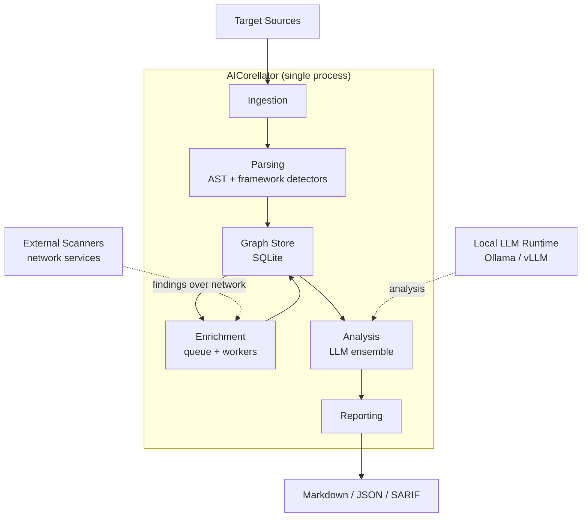

# AICorellator — C4 Level 2: Containers

**View:** Container (C4 L2) · **Date:** 2026-10-09 · **Last reviewed:** 2026-10-20 · **Status:** Accepted

---

## Diagram

---

## Containers

| Container | Responsibility | Technology |
|---|---|---|
| **Ingestion** | Accepts target sources: folder, repo, unpacked image, mounted FS. Normalizes input paths. | Python |
| **Parsing** | Runs TSA for symbols, framework detectors for framework-specific nodes and edges, capability extraction, and normalization. Produces nodes and edges, each edge carrying `flow_kind` (ADR-0015). Local subprocess for TSA; in-process for detectors and the normalizer. | TSA, Python |
| **Graph Store** | Single source of truth. Live, mutable graph: nodes, edges, findings, hosts, state, task_state. Every edge carries `flow_kind` and, where applicable, `data_flow_confirmed` (ADR-0015). | SQLite |
| **Enrichment** | Task queue. Static workers (AAK, LLM-scanner, MCP-scanner) and dynamic workers (change-detectors). Enriches vertices with findings. Not implemented (Phase 2). | Python asyncio + network clients |
| **Analysis** | LLM voting ensemble. Enumerates candidate chains deterministically, serializes them with `flow_kind` on every edge, sends to local LLM, parses verdicts, validates every reported edge. | Python + Ollama/vLLM client |
| **Reporting** | Generates report bundle dir. Manages `current/` → `<timestamp>/` archival. | Python |

---

## Relationships

| From | To | Description |
|---|---|---|
| Target Sources | Ingestion | Read-only access to code, configs, container layers |
| Ingestion | Parsing | Normalized path handed to parser |
| Parsing | Graph Store | Writes nodes and edges, with `flow_kind` on every edge |
| Graph Store | Enrichment | Provides vertices for scanning |
| Enrichment | Graph Store | Writes findings and attributes back |
| Graph Store | Analysis | Provides graph, including `flow_kind` and `data_flow_confirmed` per edge |
| Analysis | Reporting | Provides chains + reasoning |
| External Scanners | Enrichment | Findings over network |
| Local LLM Runtime | Analysis | Chain evaluation |

---

## Notes

- **Single process.** All internal containers are modules of one Python process. No Docker containers, no microservices.
- **Parsing is in-process.** TSA runs as a local subprocess; framework detectors and the AST normalizer run in the main process. SCIP is not implemented; TSA provides symbols only (backlog item 1.1).
- **External scanners are network-only.** MCP-scanner and LLM-scanner are dynamic and cannot be delivered as local subprocesses. Not implemented (Phase 2).
- **Graph Store is the only stateful container.** Everything else is stateless or derives state from the graph.
- **`flow_kind` lives in the Graph Store.** Every edge carries it (ADR-0015). Analysis reads it and includes it in the LLM payload. No container boundary changes: the attribute is stored in SQLite and serialized by the Analysis container.

---

## Next

- **C4 L3 (Component):** internal structure of Parsing, Enrichment, Analysis, Reporting. Phase 0, Phase 1, and Phase 3 are documented; Phase 2 is not.
- **C4 Deployment:** multi-host topology (Core + Agent).