# AICorellator — C4 Level 3: Components (Phase 0)

**View:** Component (C4 L3) · **Phase:** 0 — Data Model · **Date:** 2026-10-09 · **Last reviewed:** 2026-10-13 · **Status:** Accepted

---

## Scope

Phase 0 covers the **data model**: SQLite schema and the Python API over it. No parsing, no enrichment, no analysis, no reporting. The L3 diagram shows the internal structure of a single container from L2 — **Graph Store** — plus the interfaces it exposes to the future phases.

---

## Diagram

```mermaid
flowchart TB
    subgraph GS["Graph Store (SQLite)"]
        SCHEMA[Schema<br/>DDL]
        NODES[Nodes Repository]
        EDGES[Edges Repository]
        FINDINGS[Findings Repository<br/>scanner findings]
        CHAINS[Chains Repository<br/>evaluated chains]
        GROUPS[Chain Groups Repository<br/>multi-chain groups]
        HOSTS[Hosts Repository]
        STATE[State Repository<br/>per-host]
        TASKS[Task State Repository]
        REPORTS[Reports Repository<br/>bundle dirs]
        QUERY[Query Layer]
        TRIGGERS[Triggers]
    end

    FUTURE1[Parsing<br/>Phase 1] -.->|writes nodes + edges| NODES
    FUTURE1 -.->|writes nodes + edges| EDGES
    FUTURE2[Enrichment<br/>Phase 2] -.->|reads vertices| QUERY
    FUTURE2 -.->|writes scanner findings| FINDINGS
    FUTURE2 -.->|updates counters| TASKS
    FUTURE3[Analysis<br/>Phase 3] -.->|reads enriched graph| QUERY
    FUTURE3 -.->|reads findings| FINDINGS
    FUTURE3 -.->|writes evaluated chains| CHAINS
    FUTURE3 -.->|writes chain groups| GROUPS
    FUTURE4[Reporting<br/>Phase 3] -.->|reads flags| STATE
    FUTURE4 -.->|reads chains| CHAINS
    FUTURE4 -.->|writes report metadata| REPORTS
    FUTURE5[Agent registration<br/>Phase 3] -.->|writes hosts| HOSTS
```



---

## Components

### 1. Schema (DDL)

**Responsibility:** Defines the SQLite structure. Applied at startup with `PRAGMA foreign_keys = ON`, `PRAGMA journal_mode = WAL`.

**Artifacts:** `graph/schema.sql`, `schema_version` table.

**Tables:** `nodes`, `edges`, `findings`, `chains`, `chain_groups`, `hosts`, `state`, `task_state`, `reports`, `schema_version`.

**Constraints:** `CHECK` on `kind` (node and edge enums), `CHECK` on `confidence` range `[0.0, 1.0]`, `CHECK` on `severity` enum, `CHECK` on `status` enum, `CHECK` on `verdict` enum, `CHECK` on `json_valid` for every JSON column.

**Migration policy:** forward-only. At startup, compare the maximum applied `schema_version` against the code's expected version. If less — apply missing migrations. If greater — refuse to start.

**Current implementation:** the schema is applied as a single file via `executescript`. There is no `src/migrations/` directory yet. The database is recreated per scan (ADR-0003), so no migration has been needed. The forward-only policy is documented for when the schema stabilizes.

---

### 2. Nodes Repository

**Responsibility:** CRUD over the `nodes` table.

**Interface:**

- `add(node: Node) -> None`
- `get(node_id: str) -> Node | None`
- `upsert(node: Node) -> None`
- `update_attr(node_id: str, key: str, value: Any) -> None`
- `update_confidence(node_id: str, delta: float) -> None`
- `mark_stale(node_id: str) -> None`
- `mark_active(node_id: str) -> None`
- `list(kind, host_id, status, limit) -> list[Node]`
- `count(kind: str | None = None) -> int`
- `exists(node_id: str) -> bool`

**Key fields:** `id`, `kind`, `name`, `host_id`, `attributes` (JSON), `capabilities` (JSON), `confidence` (REAL), `content_hash`, `status`, `created_at`, `updated_at`.

**ID derivation:** per-kind. The normalizer computes the ID from the node's kind and identity fields. The host identifier is always part of the hash. Examples: an agent's ID is a hash of kind, file path, class name, and host; a tool's ID is a hash of kind, file path, name, and host. Two hosts producing a node with the same kind and name yield different IDs. This is required for multi-host: the same service on two hosts is two distinct nodes with distinct reachability.

**Upsert semantics:** attributes are merged key-by-key, capabilities are unioned, confidence takes the maximum, and content hash, status, kind, name, and host are overwritten.

**Content hash:** hash of the source artifact. Used for re-run caching — unchanged hash means findings are reused.

---

### 3. Edges Repository

**Responsibility:** CRUD over the `edges` table. Enforces uniqueness on `(source_id, target_id, kind, host_id)`.

**Interface:**

- `add(edge: Edge) -> None`
- `get(edge_id: str) -> Edge | None`
- `upsert(edge: Edge) -> None`
- `update_confidence(edge_id: str, delta: float) -> None`
- `mark_stale(edge_id: str) -> None`
- `list(source_id, target_id, kind, host_id, precision, status, limit) -> list[Edge]`
- `count(kind: str | None = None) -> int`
- `exists(edge_id: str) -> bool`
- `existing_ids(edge_ids: list[str]) -> list[str]`

**Key fields:** `id`, `source_id`, `target_id`, `kind`, `host_id`, `precision`, `attributes` (JSON), `capabilities` (JSON), `confidence`, `status`, `created_at`, `updated_at`.

**Edge kinds (stored):** `uses_model`, `uses_tool`, `provides_tool`, `delegates_to`, `has_access_to`, `guards`.

**Edge kinds (derived, not stored):**

- `reaches_sink` — computed by the Query Layer as a path ending in `has_access_to` to a sink node.
- `called_by` — computed by the Query Layer as the reverse of `uses_model`, `uses_tool`, `provides_tool`, `delegates_to`.

**Upsert semantics:** attributes are merged, capabilities are unioned, precision is upgraded — compiler-verified wins over syntactic — confidence takes the maximum.

**Cascade:** `ON DELETE CASCADE` from `nodes`. Removing a node removes its edges.

---

### 4. Findings Repository

**Responsibility:** CRUD over the `findings` table. A finding is a **weakness reported by a scanner**, attached to either a node or an edge — never both, never neither.

**Interface:**

- `add(finding: Finding) -> None`
- `get(finding_id: str) -> Finding | None`
- `upsert(finding: Finding) -> None`
- `mark_stale(finding_id: str) -> None`
- `mark_stale_for_node(node_id: str) -> int`
- `mark_stale_for_edge(edge_id: str) -> int`
- `list(node_id, edge_id, scanner, severity, rule_id, status, limit) -> list[Finding]`
- `count(severity, status) -> int`
- `summary() -> dict[str, int]`

**Key fields:** `id`, `node_id`, `edge_id`, `scanner`, `rule_id`, `severity`, `title`, `description`, `evidence` (JSON), `confidence`, `status`, `created_at`, `updated_at`.

**Constraint:** a finding must attach to exactly one of `node_id` or `edge_id`. Enforced at both the schema level and in the repository.

**Provenance:** the `scanner` field identifies the source — AAK, LLM-scanner, MCP-scanner. The `rule_id` is the scanner-specific rule.

**Relationship to chains:** findings are **inputs** to chain evaluation. A chain's reasoning may cite findings, but findings are not chains.

---

### 5. Chains Repository

**Responsibility:** CRUD over the `chains` table. A chain is an **evaluated compromise chain** produced by the correlator (ADR-0005, ADR-0006).

**Interface:**

- `add(chain: Chain) -> None`
- `get(chain_id: str) -> Chain | None`
- `upsert(chain: Chain) -> None`
- `mark_stale(chain_id: str) -> None`
- `mark_stale_for_node(node_id: str) -> int`
- `delete(chain_id: str) -> None`
- `list(verdict, status, validated, min_confidence, prompt_version, limit) -> list[Chain]`
- `list_actionable(min_confidence: float = 0.5) -> list[Chain]`
- `count(verdict, status) -> int`
- `summary() -> dict[str, int]`

**Key fields:**

| Field | Type | Description |
|---|---|---|
| `id` | str | Deterministic chain ID from Layer 1 (ADR-0006) |
| `chain_nodes` | JSON | Ordered node IDs |
| `chain_edges` | JSON | Ordered edge IDs |
| `verdict` | str | `exploitable` / `not_exploitable` / `uncertain` |
| `confidence` | float | Aggregated (ADR-0005) |
| `reasoning` | str | Judge reasoning or aggregated voters' reasoning |
| `voter_outputs` | JSON | Raw voter responses (ADR-0005) |
| `prompt_version` | str | Prompt version used (ADR-0005) |
| `validated` | bool | True if existence and all semantic checks passed (ADR-0018) |
| `validated_kind` | str | NULL | `"existence"` (only existence passed) or `"semantic"` (all checks passed); NULL on pre-A.4 rows, read as `"existence"` |
| `validation_notes` | JSON | `list[str]` — one note per failed check; [] when all pass |
| `status` | str | `active` / `stale` |
| `created_at` | timestamp | |

**Constraint:** `CHECK` on `verdict`, `CHECK` on `confidence` range.

**Validation flag:** `validated = false` means the chain was rejected as a hallucination (ADR-0006 Layer 3). Such chains are stored but not surfaced in reports.

**Candidate chains are NOT stored.** Only evaluated chains. Candidates are transient.

---

### 6. Chain Groups Repository

**Responsibility:** CRUD over the `chain_groups` table. A chain group is a set of chains that meet through an untrusted source (ADR-0010, ADR-0012).

**Interface:** not yet implemented. The table exists in the schema; no repository class is present in the codebase.

**Key fields:** `id`, `name`, `untrusted_source_id`, `write_chain_ids` (JSON), `read_chain_ids` (JSON), `lethal_trifecta` (boolean), `score`, `score_components` (JSON), `verdict`, `confidence`, `reasoning`, `validated`, `priority`, `status`, `created_at`, `updated_at`.

**Status:** schema-ready, implementation deferred to Phase 2 (ADR-0010).

---

### 7. Hosts Repository

**Responsibility:** CRUD over the `hosts` table. In Phase 0 there is always one row: `localhost`.

**Interface:**

- `register(host: Host) -> None`
- `get(host_id: str) -> Host | None`
- `upsert(host: Host) -> None`
- `update_heartbeat(host_id: str) -> None`
- `mark_unreachable(host_id: str) -> None`
- `list(status) -> list[Host]`
- `exists(host_id: str) -> bool`

**Key fields:** `id`, `hostname`, `ip`, `platform`, `agent_version`, `last_heartbeat`, `status`, `created_at`.

**Phase 0 bootstrap:** on first startup, insert `localhost` with `platform = 'standalone'`.

**Phase 3 note:** agent registration writes here.

---

### 8. State Repository (per-host)

**Responsibility:** Key-value flags for pipeline lifecycle, **scoped per host**.

**Interface:**

- `get(host_id: str, key: str) -> str | None`
- `get_bool(host_id: str, key: str) -> bool`
- `get_int(host_id: str, key: str) -> int`
- `set(host_id: str, key: str, value) -> None`
- `unset(host_id: str, key: str) -> None`
- `all(host_id: str) -> dict[str, str | None]`
- `global_flag(key: str) -> bool`
- `global_int_min(key: str) -> int`

**Primary key:** `(host_id, key)`.

**Expected keys per host:** `phase1_done`, `scan_done`, `report_fresh`, `last_report_at`, `dynamic_enabled`, `cleanup_stale_days`, `cleanup_findings_days`, `cleanup_chains_days`, `cleanup_reports_days`.

**Global derivation:** `global_flag("scan_done")` returns true only if **every** active host has `scan_done = true`. This is a query, not a stored value.

**Rationale:** in multi-host, `scan_done` on host A does not mean `scan_done` on host B. A global flag derived from per-host flags is the only consistent model.

---

### 9. Task State Repository

**Responsibility:** Counters for the enrichment queue. Two rows per host, one per worker kind.

**Interface:**

- `task_started(host_id, kind) -> None`
- `task_done(host_id, kind) -> None`
- `task_failed(host_id, kind) -> None`
- `task_timeout(host_id, kind) -> None`
- `mark_cycle_complete(host_id, kind) -> None`
- `reset(host_id, kind) -> None`
- `get(host_id, kind) -> TaskCounter`
- `list(host_id) -> list[TaskCounter]`
- `is_scan_done(host_id) -> bool`
- `is_dynamic_alive(host_id) -> bool`

**Primary key:** `(host_id, kind)`.

**Rows:** `static`, `dynamic` — per host.

**Fields:** `host_id`, `kind`, `active_count`, `done_count`, `failed_count`, `timeout_count`, `last_completed_at`, `updated_at`.

**Failure semantics:** `scan_done` is defined as "all tasks in terminal state (done | failed | timeout)", not "active_count = 0". The schema carries per-terminal-state counters so this definition can be honored.

---

### 10. Reports Repository

**Responsibility:** Metadata about generated reports. The report itself is a **bundle directory** on disk.

**Interface:**

- `add(report: Report) -> None`
- `get(report_id: str) -> Report | None`
- `get_current(host_id: str) -> Report | None`
- `get_by_bundle(host_id: str, bundle_dir: str) -> Report | None`
- `archive_current(host_id: str, timestamp: str) -> None`
- `set_current(report_id: str) -> None`
- `delete(report_id: str) -> None`
- `list(host_id, tier, limit) -> list[Report]`
- `count(host_id) -> int`

**Key fields:** `id`, `host_id`, `bundle_dir`, `tier` (`fast` | `full`), `is_current`, `generated_at`, `metadata` (JSON).

**Bundle structure:**

```
current/
├── report.md
├── chains.json
```

**Archival:** on new report generation, `current/` is renamed to a timestamped directory, and a fresh `current/` is created. The `is_current` flag moves to the new row.

**Constraint:** partial unique index on `(host_id, is_current = 1)` — only one current report per host.

**Current implementation note:** the tier column exists in the schema, but only a single report type is generated. The `fast` / `full` tiers are deferred (ADR-0004).

---

### 11. Query Layer

**Responsibility:** Read-only queries that span repositories. Used by Analysis (Phase 3) to enumerate candidates and serialize graph slices.

**Interface:**

- `get_neighbors(node_id: str, depth: int = 1) -> GraphSlice`
- `get_subgraph(node_kinds, edge_kinds, status) -> GraphSlice`
- `find_chains(entry_kinds, sink_kinds, max_hops, max_candidates) -> list[CandidateChain]`
- `validate_edges(edge_ids: list[str]) -> tuple[list[str], list[str]]`
- `is_chain_valid(chain_nodes, chain_edges) -> bool`

**`find_chains` semantics (ADR-0006, ADR-0014):**

- **Enumerates** structural paths. Does not evaluate.
- **Sink set** is the union of two conditions: nodes whose kind is in `sink_kinds`, and nodes whose capabilities include at least one sink capability (ADR-0014).
- **Bounded** by `max_hops` and `max_candidates`.
- **Implementation:** Python iterative DFS with a per-path visited set, not a SQLite recursive CTE. The cycle guard is native, and the graph sizes the project targets make DFS fast enough.
- **Returns:** `CandidateChain` records carrying `chain_id`, `nodes`, `edges`, `length`.

**`validate_edges` semantics (ADR-0006 Layer 3):**

- Takes a list of edge IDs from an LLM's `evidence` field.
- Returns two lists: existing edge IDs and missing edge IDs, preserving input order.
- Used to reject hallucinated chains.

**`is_chain_valid`:** boolean wrapper that also checks node existence.

**Derived edges:** `reaches_sink` and `called_by` are computed here, not stored.

---

### 12. Triggers

**Responsibility:** Keep `updated_at` fresh after any `UPDATE`.

**Artifacts:** triggers on `nodes`, `edges`, `findings`, `chains`, `chain_groups`. Each trigger fires when the new `updated_at` equals the old one, and sets it to the current timestamp.

---

## Cleanup Policy

**Responsibility:** Prevent unbounded growth of the single SQLite file across re-runs.

**Parameters (stored in `state`, per host or global):**

| Key | Default | Meaning |
|---|---|---|
| `cleanup_stale_days` | 30 | Delete nodes with `status = 'stale'` older than N days |
| `cleanup_findings_days` | 90 | Delete findings with `status = 'stale'` older than N days |
| `cleanup_chains_days` | 90 | Delete chains with `status = 'stale'` older than N days |
| `cleanup_reports_days` | 365 | Delete report bundle directories older than N days (metadata kept) |

**Execution:** at startup, after migrations. Runs in a transaction. Cascade deletes handle edges and findings attached to removed nodes.

**Rationale:** the graph is alive and mutable, but "no versioning" does not mean "no cleanup". Stale nodes that have been gone for a month are unlikely to be relevant.

---

## Interfaces to Future Phases

| Phase | Component | Reads | Writes |
|---|---|---|---|
| 1 | Parsing | — | `nodes`, `edges` |
| 2 | Enrichment | `nodes`, `edges` | `findings`, `nodes.attributes`, `task_state` |
| 3 | Analysis | `nodes`, `edges`, `findings` | `chains`, `chain_groups` |
| 3 | Reporting | `state`, `chains`, `findings`, `nodes` | `reports`, `state` |
| 3 | Agent registration | — | `hosts` |

---

## What Is NOT Shown

- **Parsing internals** — Phase 1 component view.
- **Enrichment internals** — Phase 2 component view.
- **Analysis internals** — Phase 3 component view.
- **Reporting internals** — Phase 3 component view.
- **Multi-host sync protocol** — Phase 3 open question.

---

## Design Notes

1. **Single stateful component.** Everything else derives state from SQLite. No in-memory caches in Phase 0.
2. **Repositories are thin.** Each is a Python class wrapping prepared statements. No ORM — SQLite driver only.
3. **Query Layer is the only cross-repository reader.** Direct SQL in Analysis and Reporting is forbidden; they go through the Query Layer.
4. **`confidence` is a float, not a boolean.** Staleness is gradual. `mark_stale` is a convenience for hard invalidation, but the primary mechanism is `update_confidence` with a delta.
5. **`content_hash` on nodes enables re-run caching.** Unchanged node means findings reused. Changed node means findings invalidated.
6. **Findings and chains are separate tables.** Findings are scanner-reported weaknesses. Chains are correlator-evaluated compromise paths. The naming distinction is deliberate.
7. **Canonical IDs include `host_id`.** Required for multi-host. Two hosts with identical code produce distinct nodes.
8. **State is per-host.** Global flags are derived by query, not stored.
9. **Reports are bundle directories.** Not single files.
10. **Migration policy is forward-only.** No downgrade. Version mismatch causes refusal to start. Current implementation applies the schema as a single file; numbered migrations are deferred until the schema stabilizes.
11. **Capabilities are first-class.** Both nodes and edges carry a JSON capability list (ADR-0009). Chain enumeration treats nodes with sink capabilities as valid endpoints (ADR-0014).
12. **`uses_tool` is a stored edge kind.** Introduced for cross-file agent-to-tool edges (ADR-0013).