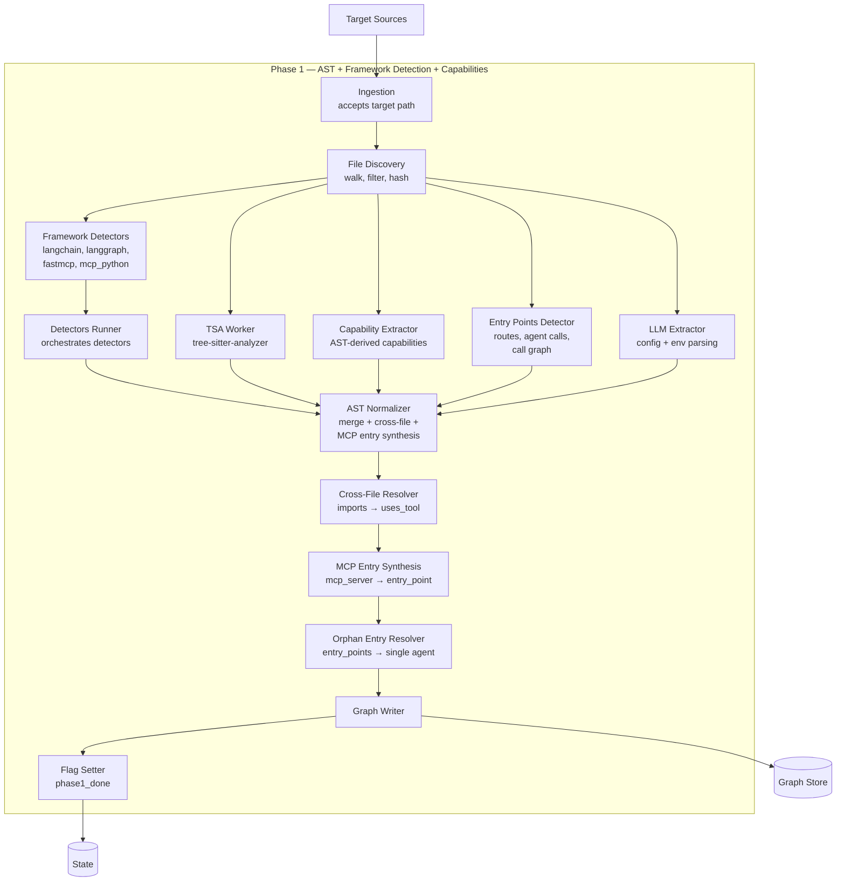

# AICorellator — C4 Level 3: Components (Phase 1)

**View:** Component (C4 L3) · **Phase:** 1 — AST + Framework Detection + Capabilities · **Date:** 2026-10-09 · **Last reviewed:** 2026-10-13 · **Status:** Accepted

---

## Scope

Phase 1 covers **graph population from source code and configs**. It takes a target directory, discovers files, parses them with tree-sitter-analyzer, extracts capabilities, runs framework detectors, resolves entry points and LLM endpoints, and normalizes everything into a graph delta written to the Graph Store.

No enrichment (Phase 2). No analysis (Phase 3). No reporting (Phase 3).

The phase has three classification layers (ADR-0009, ADR-0011):

- **Level 1** — framework detectors, per-file, framework-specific.
- **Level 2** — capability extraction, framework-agnostic.
- **Level 3** — name-based heuristics, the original FinBot-tuned rules.

Cross-file edges and MCP entry synthesis are resolved by the normalizer after detector merge (ADR-0013).

---

## Diagram

---

## Components

### 1. Ingestion

**Responsibility:** Accepts a target path — folder, repo root, unpacked image, or mounted FS. Normalizes it into an absolute root path. Validates that the path exists and is readable.

**Interface:**

- `ingest(path, kind) -> Target`
- `Target.root: Path`
- `Target.kind: str` — `folder` | `repo` | `image` | `mount`

**Phase 1 note:** only `folder`, `repo`, and `mount` are supported. Image unpacking is a Phase 3 agent responsibility.

---

### 2. File Discovery

**Responsibility:** Walks the target tree, applies include/exclude rules, computes a content hash per file. Produces a manifest of files to parse.

**Interface:**

- `discover(target: Target) -> FileManifest`
- `FileManifest.files: list[FileEntry]`
- `FileEntry.path: str` — relative to target root, POSIX separators
- `FileEntry.abs_path: Path`
- `FileEntry.language: str | None`
- `FileEntry.content_hash: str`

**Exclude rules:** `.git/`, `node_modules/`, `__pycache__/`, `venv/`, `.venv/`, `dist/`, `build/`, and other VCS and build artifacts. Hidden files are skipped except a small allowlist (`.env`, `.gitignore`, `.dockerignore`).

**Symlinks are not followed.** This avoids loops and escapes from the target root.

**Language detection:** by extension. Languages supported by TSA are enumerated in the patterns registry.

---

### 3. TSA Worker

**Responsibility:** Runs `tree-sitter-analyzer` on each supported file. Produces a language-agnostic index of classes, methods, and functions.

**Interface:**

- `run(manifest: FileManifest, root: Path) -> TSAOutput`
- `TSAOutput.symbols: list[TSASymbol]`
- `TSAOutput.precision: str` — always `syntactic`
- `TSAOutput.files_analyzed: int`
- `TSAOutput.files_failed: int`

**Invocation:** `uvx --from tree-sitter-analyzer` as a local subprocess. No venv, no Node, no compiler required.

**Output format:** JSON. Parsed into `TSASymbol` records carrying name, kind, file path, line range, and optional enclosing class.

**Always runs.** This is the baseline. If TSA fails on a file, the file is logged and skipped; the rest continue.

**SCIP is deferred.** ADR-0002 originally proposed an optional SCIP worker as a precision layer. It is not implemented. The `precision` attribute exists on edges, but no producer writes `compiler-verified` yet.

---

### 4. Capability Extractor

**Responsibility:** Derives capabilities from the AST (ADR-0009). For each symbol in a file, scans its body for known call patterns and records the capabilities exercised.

**Interface:**

- `extract(file_path: Path, relative_path: str) -> FileCapabilities`
- `FileCapabilities.file_path: str`
- `FileCapabilities.symbols: list[SymbolCapabilities]`
- `FileCapabilities.module_capabilities: set[str]`

**Capabilities emitted:** `executes_code`, `executes_shell`, `reads_filesystem`, `writes_filesystem`, `reads_db`, `writes_db`, `http_egress`, `reads_env`, `reads_secrets`, `calls_llm`, `invokes_mcp_tool`.

**Not emitted:** `reads_untrusted` (requires untrusted-source detection, ADR-0010, deferred), `http_ingress` (entry points are detected by kind, not capability).

**Design:** call-site based, not dataflow. False positives are accepted; they are better than no signal. The LLM in Phase 3 explains and prioritizes.

**Nested functions are scanned.** Functions defined inside factories are found by name, so `@tool`-decorated closures receive their capabilities.

---

### 5. Framework Detectors

**Responsibility:** Recognize a specific AI framework in one file and extract nodes and edges from that framework's conventions (ADR-0011).

**Interface:**

- `detect(file_path, tree, source, host_id) -> DetectionResult`
- `DetectionResult.nodes: list[Node]`
- `DetectionResult.edges: list[Edge]`
- `DetectionResult.framework: str`
- `DetectionResult.detected_version: str | None`

**Implemented detectors:** LangChain, LangGraph, FastMCP, MCP Python SDK.

**Per-file contract.** A detector receives one file and returns nodes and edges from that file alone. No import resolution, no global state, safe for parallel execution.

**What detectors emit:**

- **LangChain**: `agent` nodes from `AgentExecutor`, `initialize_agent`, `create_agent`; `tool` nodes from `@tool`, `Tool(...)`, `StructuredTool.from_function(...)`; `llm_endpoint` nodes from `ChatOpenAI`, `ChatAnthropic`, `ChatOllama`, and others. Tool bodies are scanned for capabilities. Within-file `uses_tool` and `uses_model` edges when the agent's `tools=` or `model=` argument can be resolved in the same file.
- **LangGraph**: graph nodes from `graph.add_node(...)`, graph edges from `graph.add_edge(...)` and `graph.add_conditional_edges(...)`, entry points from `graph.set_entry_point(...)`. Node kind is inferred from the node name.
- **FastMCP**: `mcp_server` nodes from `FastMCP(...)`; `tool` nodes from `@<var>.tool(...)` decorators, with `parent_server` set. Tool bodies are scanned for capabilities.
- **MCP Python SDK**: `mcp_server` nodes from `Server(...)`; `tool` nodes from `@<var>.call_tool()` decorators, with `parent_server` set. Other server-bound decorators (`list_resources`, `read_resource`) are recognized but not emitted as tools.

**Cross-file edges are not the detector's job.** They are resolved by the normalizer (ADR-0013).

**Registry:** `framework_detectors/registry.py` maps names to detector classes. Adding a detector is one line.

**Version support:** each detector declares a supported version range. If the detected framework version is outside the range, a warning is logged and detection proceeds at the user's risk.

---

### 6. Detectors Runner

**Responsibility:** Orchestrates all enabled framework detectors across a file manifest.

**Interface:**

- `run(manifest, enabled, host_id) -> DetectionResult`

**Behavior:** for each Python file, parses the AST once, then invokes each enabled detector on that AST. Merges all returned nodes and edges into a single `DetectionResult`.

**Error handling:** a detector that raises on a file is logged and skipped. Other detectors continue.

**Enabled names:** user-supplied via CLI flag. If none supplied, all registered detectors run.

---

### 7. Entry Points Detector

**Responsibility:** Finds HTTP routes, WebSocket handlers, agent calls inside route bodies, MCP usages (`create_mcp_server` calls) in Python code, and builds a per-file call graph.

**Interface:**

- `run(manifest, known_agents) -> EntryPointOutput`
- `EntryPointOutput.entry_points: list[EntryPoint]`
- `EntryPointOutput.agent_calls: list[AgentCall]`
- `EntryPointOutput.mcp_usages: list[MCPUsage]`
- `EntryPointOutput.call_graph: dict[str, set[str]]`

**Route detection:** decorators whose attribute is an HTTP method or `websocket`. Handler name, path, method, and line are recorded.

**Agent call detection:** four heuristics — delegation suffix (`delegate_to_*`), runner-function mapping (`run_*_agent`), extra agent classes, and direct class calls. Calls inside agent modules are flagged as agent-to-agent.

**MCP usage detection:** calls to `create_mcp_server("name", ...)` record the enclosing handler and the server name.

**Call graph:** for every `FunctionDef`/`AsyncFunctionDef` in the file (route handler or not), the set of names it calls via `ast.Name` targets. Used by the normalizer to resolve entry-point-to-sink reachability (ADR-0013, cross-file reachability resolver).

**Not in scope:** entry points from factory functions (`get_agent(...)`) not named in the heuristics. This is handled by the orphan-entry resolver (ADR-0013).

---

### 8. LLM Extractor

**Responsibility:** Reads config files and extracts LLM endpoint information. This is the component that closes the "agent to model" gap.

**Interface:**

- `run(manifest) -> LLMExtractorOutput`
- `LLMExtractorOutput.endpoints: list[LLMEndpoint]`
- `LLMExtractorOutput.deduplicated() -> list[LLMEndpoint]`

**Files scanned:** `.env` and variants, Python config files, YAML (including docker-compose), TOML, JSON.

**Detection patterns:** provider keys (`LLM_PROVIDER`), model keys (`LLM_MODEL`, `*_MODEL`), base URL keys (`*_BASE_URL`, `*_ENDPOINT`), and provider-specific keys (`OPENAI_*`, `ANTHROPIC_*`, `OLLAMA_*`).

**Deduplication:** one endpoint per unique `(provider, model, base_url)` triple.

---

### 9. AST Normalizer

**Responsibility:** The central merge component. Takes all Phase 1 outputs and produces a single `GraphDelta` of nodes and edges.

**Interface:**

- `normalize(manifest, tsa_output, entry_points, llm_output, capabilities, framework_detection) -> GraphDelta`
- `GraphDelta.nodes: list[Node]`
- `GraphDelta.edges: list[Edge]`

**Pipeline inside the normalizer:**

1. **MCP server nodes** — from file paths under `mcp/servers/`.
2. **Class nodes** — Level 3 classification, with Level 2 capabilities supplied as input.
3. **Method nodes** — Level 3 classification, with capabilities. Tools and sinks are tracked per file.
4. **Intra-file edges** — `provides_tool` (MCP server to tool), `has_access_to` (tool to sink).
5. **Entry point nodes** — from the entry points detector.
6. **LLM endpoint nodes** — from the LLM extractor.
7. **Delegation edges** — entry point to agent, agent to agent, agent to MCP server.
8. **Detector node merge** — detector nodes are authoritative for kind. When a detector node and a TSA node share name and source file, the detector node replaces the TSA node. Capabilities are merged from the TSA node if the detector node has none. Edges pointing at the removed node are re-pointed to the replacement, and their IDs are recomputed and deduplicated.
9. **Cross-file resolution** — `uses_tool` edges from agent modules to tool modules they import (ADR-0013, Resolver 1).
10. **MCP entry synthesis** — for each `mcp_server` node carrying a `framework` attribute, create a virtual `entry_point` node named `MCP:<server_name>` and emit `delegates_to` edges to every tool whose `parent_server` matches (ADR-0013, Resolver 3).
11. **Orphan entry resolution** — `delegates_to` edges from entry points with no outgoing delegation edge to the single framework agent in the project (ADR-0013, Resolver 2).
12. **Entry-point-to-sink reachability** — `has_access_to` edges from entry points (HTTP and MCP) to sinks reachable through same-file calls (ADR-0013, cross-file reachability resolver).

**Key invariants:**

- All IDs are deterministic. Same input produces the same delta.
- Detector nodes are authoritative for kind; capabilities are preserved across the merge.
- Removed nodes do not leave dangling edges.
- MCP entries are marked with `entry_kind = "mcp"`; HTTP routes remain unmarked.

---

### 10. Cross-File Resolver

**Responsibility:** Resolve edges that cannot be seen from a single file (ADR-0013).

**Implemented in:** `framework_detectors/cross_file.py`.

**Function:**

- `resolve_agent_tool_edges(manifest, detector_nodes, host_id) -> list[Edge]`

**Algorithm:** index tools by source file, index framework agents, collect per-file imports, match imported module names to file paths by trailing segments, emit `uses_tool` edges from each agent to every tool in each matched file.

**Design:** false positives accepted. An agent that imports a module with twenty tools receives edges to all twenty. Phase 3 filters.

---

### 11. Graph Writer

**Responsibility:** Writes the `GraphDelta` into the Graph Store. Deduplicates by canonical ID.

**Interface:**

- `write(store: GraphStore, delta: GraphDelta, host_id: str) -> dict[str, int]`
- `set_phase1_done(store: GraphStore, host_id: str) -> None`

**Return value:** counts of added and updated nodes and edges.

**Deduplication:** handled by the repository `upsert` methods. Attributes are merged, capabilities are unioned, confidence takes the maximum, precision is upgraded.

---

### 12. Flag Setter

**Responsibility:** Sets `phase1_done = true` in the State table after a successful write.

**Effect:** the graph becomes available for Phase 3 evaluation and reporting.

---

## Data Flow

| Step | Input | Output |
|---|---|---|
| Ingestion | target path | normalized `Target` |
| File Discovery | `Target` | `FileManifest` |
| Capability Extractor | manifest | per-file `FileCapabilities` |
| TSA Worker | manifest + root | `TSAOutput` (symbols) |
| Framework Detectors | manifest | `DetectionResult` (nodes + edges) |
| Entry Points Detector | manifest | `EntryPointOutput` (routes, agent calls, call graph) |
| LLM Extractor | manifest | `LLMExtractorOutput` |
| AST Normalizer | all of the above | `GraphDelta` |
| Graph Writer | `GraphDelta` | rows in `nodes`, `edges` |
| Flag Setter | — | `phase1_done = true` |

---

## Interfaces to Other Phases

| Direction | Component | Interface |
|---|---|---|
| Phase 1 → Phase 0 | Graph Writer | Nodes and Edges repositories |
| Phase 1 → Phase 2 | Flag Setter | `state.phase1_done` |
| Phase 1 → Phase 3 | — | Graph is available for chain enumeration |

---

## What Is NOT Shown

- **Enrichment internals** — Phase 2.
- **Analysis internals** — Phase 3.
- **Reporting internals** — Phase 3.
- **Multi-host delivery** — Phase 3.
- **SCIP worker** — deferred (ADR-0002, ADR-0003).
- **Precision merge** — deferred with SCIP.
- **Cross-file tool to sink.** Same-file reachability is implemented; cross-file requires call-graph extension across imports. Deferred.

---

## Design Notes

1. **TSA is the baseline.** It always runs. SCIP is an optional enrichment on top, deferred.
2. **LLM Extractor is the critical gap-closer.** AAK and agent-bom do not connect agents to models. This component does.
3. **Classification is layered.** Framework detectors (Level 1) are authoritative; capability extraction (Level 2) overrides name-based heuristics when it disagrees; name-based heuristics (Level 3) are the fallback.
4. **Canonical IDs are per-kind.** Same identity fields produce the same ID. Re-runs reuse existing nodes.
5. **`content_hash` enables re-run caching.** Unchanged file means unchanged hash, and Phase 2 findings can be reused.
6. **No dynamic behavior.** Phase 1 sees only static artifacts. Dynamic tool registration, runtime endpoints, and env-based configuration are invisible unless they appear in files.
7. **Detectors are per-file.** Cross-file resolution is a normalizer concern. This preserves the detector contract and makes detectors independently testable.
8. **False positives are accepted.** Both capability extraction and cross-file resolution prefer a spurious edge over a missing one. The LLM ensemble in Phase 3 prioritizes and filters.
9. **Capabilities override kind at chain time.** A tool with `executes_code` is a valid chain endpoint, even though its kind is `tool` (ADR-0014).
10. **`uses_tool` is a stored edge kind.** Introduced for cross-file agent-to-tool edges (ADR-0013).
11. **MCP entries are virtual.** They do not correspond to an HTTP route; they model "an MCP client can invoke this server's tools". Marked with `entry_kind = "mcp"` so downstream can distinguish.
12. **Two MCP detectors, one entry synthesis.** FastMCP and the Python SDK are detected separately (different imports, different decorators), but the MCP entry synthesis is shared. Adding a third MCP SDK means adding one detector; the synthesis already works.
13. **Call-graph reachability extends to MCP.** The `_link_entry_points_to_sinks` resolver operates on any entry point, including synthesized MCP entries. A chain can start at an MCP tool and reach a sink through same-file calls.

---

## Next

- **Phase 2 L3:** Enrichment (queue, workers, network clients).
- **Phase 3 L3:** Analysis, Reporting.
- **C4 Deployment:** Core + Agent topology.