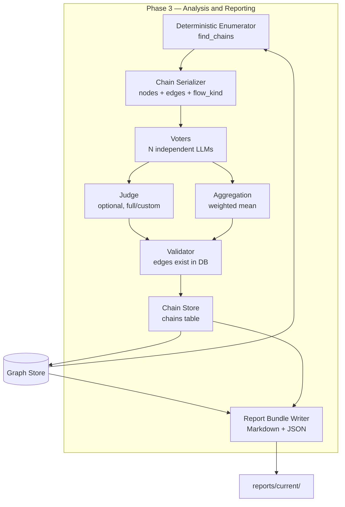

# AICorellator — C4 Level 3: Components (Phase 3)

**View:** Component (C4 L3) · **Phase:** 3 — Analysis and Reporting · **Date:** 2026-10-20 · **Status:** Accepted

---

## Scope

Phase 3 covers **chain evaluation and report generation**. It reads the graph produced by Phase 1, enumerates candidate chains deterministically, evaluates each chain with a local LLM voting ensemble, validates every reported edge against the graph, and produces a report bundle.

No parsing (Phase 1). No enrichment (Phase 2).

Two components are covered:

- **Analysis** — the evaluation ensemble: enumeration, voters, judge, aggregation, validation.
- **Reporting** — the bundle writer: Markdown and JSON output, archival.

Phase 3 does not modify the graph. It reads nodes and edges, writes evaluated chains (`chains` table), and writes a report bundle to disk.

Every edge in the graph carries `flow_kind` — `control`, `data`, or `structural` (ADR-0015). The evaluation payload includes `flow_kind` and, for `has_access_to`, `data_flow_confirmed`. The LLM uses these signals to calibrate confidence; it does not apply hard rules.

---

## Diagram



---

## Components

### 1. Deterministic Enumerator

**Responsibility:** Enumerates candidate chains from the graph (ADR-0006, Layer 1).

**Interface:**

- `find_chains(entry_kinds, sink_kinds, max_hops, max_candidates, data_edges_only) -> list[CandidateChain]`
- `CandidateChain.chain_id: str`
- `CandidateChain.nodes: list[str]`
- `CandidateChain.edges: list[str]`
- `CandidateChain.length: int`

**Algorithm:** iterative DFS from each entry point through the graph. The sink set is the union of nodes whose kind is in `sink_kinds` and nodes whose capabilities include a sink capability (ADR-0014).

**Edge traversal:**

- `control` and `data` edges are traversed.
- `provides_tool` is `control` and **is** traversed. The access path from an agent to a tool an MCP server exposes is the candidate attack path: "the agent can call the tool" is the step an attacker uses (ADR-0015).
- `guards` is `structural` and is **not** traversed. A guardrail is a defensive control, not a step in an attack path (ADR-0015).

**`data_edges_only` parameter:**

- `False` (default) — all chains. Control-only chains are enumerated. The LLM weighs them against data chains.
- `True` — only chains where at least one edge has `flow_kind = "data"`. High-precision shortlist. Partial chains needed by chain groups (ADR-0010) are excluded by this filter; that is the analyst's choice.

**Bounded** by `max_hops` (default 6) and `max_candidates` (default 1000).

**Returns** candidate chains. Not evaluated. Transient — never stored.

---

### 2. Chain Serializer

**Responsibility:** Converts a candidate chain into the payload the LLM receives.

**Interface:**

- `_node_to_dict(store, node_id) -> dict`
- `_edge_to_dict(store, edge_id) -> dict`

**Node payload:**

- `id`, `kind`, `name`
- `attributes` (source file, line range, framework, parent server, entry kind)
- `capabilities` (ADR-0009)
- `confidence`

**Edge payload:**

- `id`, `kind`, `source_id`, `target_id`
- `attributes`
- `capabilities` (ADR-0009)
- `precision`
- **`flow_kind`** — `control` | `data` | `structural` (ADR-0015)
- **`data_flow_confirmed`** — for `has_access_to` only; one of `parameter_match`, `local_var_match`, `call_result_match`, `literal_only`, `no_args`, `unknown` (ADR-0015)

**Design:** the serializer exposes everything the prompt needs. If the prompt asks about capabilities or flow kind, those fields must be in the payload. This was a bug fixed in the P0/P2 review (commit 2263fa7): capabilities were not serialized, so the prompt asked about data the LLM never saw.

---

### 3. Voters

**Responsibility:** Evaluate a candidate chain independently (ADR-0005).

**Interface:**

- `evaluate(chain_id, chain_nodes, chain_edges, voters, temperature, max_tokens, parallel, mode) -> list[VoterResponse]`

**Modes:**

- `fast` — one voter, no reasoning, voter prompt.
- `solo` — one voter, reasoning, solo prompt (combined voter and judge).
- `full` — N voters, voter prompt, followed by the judge.
- `custom` — as configured.

**Voter response:**

- `chain_id`, `model`, `prompt_version`
- `exploitable: bool` — must be a real JSON boolean. A string or integer is treated as an invalid response and excluded from aggregation (P0/P2 fix).
- `confidence: float`
- `reasoning: str`
- `evidence: list[str]` — edge IDs cited by the voter. Validated against the candidate chain (see below).
- `evidence_valid: list[str]` — subset of `evidence` that exists in the candidate chain.
- `evidence_unknown: list[str]` — evidence IDs not found in the candidate chain.
- `timeout: bool`

**Parallel execution:** `ThreadPoolExecutor` when `parallel=True`. Sequential by default, because LMStudio with default settings evicts models under concurrent load.

**Timeout:** per-voter. A timed-out voter is excluded from aggregation.

---

### 4. Judge

**Responsibility:** Issues the final verdict after seeing all voters (ADR-0005).

**Interface:**

- `evaluate(chain_id, chain_nodes, chain_edges, voter_responses, judge, temperature, max_tokens) -> JudgeResponse | None`

**Enabled in:** `full` and `custom` modes. Disabled in `fast` and `solo`.

**Judge response:**

- `chain_id`, `model`, `prompt_version`
- `verdict: str` — `exploitable` | `not_exploitable` | `uncertain`
- `confidence: float`
- `reasoning: str`

**Per-judge overrides:** `temperature` and `max_tokens` from the config are honored (P0/P2 fix). A deterministic judge is a configuration choice, not a code default.

**Fallback:** if the judge times out or returns unparseable output, the aggregated voters' verdict is used. The chain is not marked as an error.

---

### 5. Aggregation

**Responsibility:** Combines voter responses into a verdict and confidence, when the judge is not used (ADR-0005).

**Interface:**

- `aggregate(responses: list[VoterResponse], voters: list[VoterConfig]) -> tuple[str, float]`

**Rules:**

- Weighted mean of confidence: `Σ(confidence_i × weight_i) / Σ(weight_i)`.
- Weighted vote on `exploitable`. Ties go to `uncertain`.
- Timed-out voters are excluded. If all voters timed out, result is `uncertain` with confidence `0.0`.

---

### 6. Validator

**Responsibility:** Deterministic validation of the reported chain (ADR-0006, Layer 3).

**Interface:**

- `is_chain_valid(chain_nodes, chain_edges) -> bool`
- `validate_edges(edge_ids) -> tuple[list[str], list[str]]`

**Rules:**

- Every node in `chain_nodes` must exist in the `nodes` table.
- Every edge in `chain_edges` must exist in the `edges` table.
- If any node or edge is missing, the chain is rejected as a hallucination.

**`evidence` validation** (P0/P2 fix): each voter's `evidence` list is validated against the **candidate chain**, not the whole graph. An evidence edge that does not appear in the candidate chain is recorded as `evidence_unknown` and does not support the verdict. This catches voters that cite plausible-looking edges outside the chain under evaluation.

**Result:** `Chain.validated = true | false`. Chains with `validated = false` are stored but not surfaced in reports.

---

### 7. Chain Store

**Responsibility:** Persists evaluated chains (ADR-0006).

**Interface:** via `ChainsRepository`.

**Fields:** `id`, `chain_nodes`, `chain_edges`, `verdict`, `confidence`, `reasoning`, `voter_outputs`, `prompt_version`, `validated`, `status`, `created_at`.

**`voter_outputs`:** raw voter responses, for provenance. The P0/P2 review noted that raw voter text is dropped before persistence (`d.pop("raw")`). Storing raw payloads is a policy decision (DB size vs audit trail); it is deferred (backlog item "Raw voter response persistence").

**No candidate chains are stored.** Candidates are transient.

---

### 8. Report Bundle Writer

**Responsibility:** Produces the report bundle on disk.

**Interface:**

- `write_bundle(store, workspace, host_id, archive_existing) -> Path`
- `render_report(store, host_id) -> str`

**Bundle structure:**

```
reports/current/
├── report.md
└── chains.json
```

**Archival:** on new report generation, `current/` is renamed to a timestamped directory, and a fresh `current/` is created.

**Report content:**

- Header: host, timestamp.
- Summary: node, edge, chain counts.
- Nodes by kind.
- Edges by kind.
- Evaluated chains, grouped by entry point, with verdict, confidence, reasoning.

**Report on demand.** Evaluation is expensive; the report is generated only when requested (ADR-0004).

---

## Data Flow

| Step | Input | Output |
|---|---|---|
| Enumerate | graph (nodes + edges with `flow_kind`) | candidate chains |
| Serialize | candidate chain | node and edge dicts with `flow_kind`, `data_flow_confirmed`, capabilities |
| Evaluate (voters) | serialized chain | voter responses |
| Evaluate (judge) | serialized chain + voter responses | final verdict |
| Aggregate | voter responses | verdict + confidence (if judge absent) |
| Validate | candidate chain | `validated: bool` |
| Store | chain + verdict + confidence + voter outputs | `chains` row |
| Report | graph + chains | `reports/current/` bundle |

---

## Prompt Contract

The prompt (v1.4.1, ADR-0015) receives per chain:

- **Nodes** — kind, name, attributes, capabilities, confidence.
- **Edges** — kind, source, target, attributes, capabilities, precision, `flow_kind`, `data_flow_confirmed`.

**What the prompt tells the LLM about `flow_kind`:**

- A chain with `data` edges is stronger evidence than a chain with only `control` edges. Data flow that is confirmed is a real path.
- A chain with `structural` edges on its path is a construction error and should be reported as such.
- `data_flow_confirmed` (when present) describes how the data flow was established: `parameter_match` and `local_var_match` are direct; `call_result_match` is inferential; `literal_only`, `no_args`, and `unknown` mean data flow was not confirmed.
- The LLM decides confidence. No hard calibration rules are imposed by the prompt.

**Untrusted content:** all node and edge attributes are wrapped in `[UNTRUSTED_DATA]` markers. The system prompt instructs the model that content within markers is data, not instructions (ADR-0005, prompt safety).

---

## Interfaces to Other Phases

| Direction | Component | Interface |
|---|---|---|
| Phase 1 → Phase 3 | Graph Store | Nodes and edges, with `flow_kind` on every edge |
| Phase 3 → Graph Store | Chain Store | `chains` table |
| Phase 3 → Disk | Report Bundle Writer | `reports/current/` |
| Phase 3 → Local LLM | Voters, Judge | OpenAI-compatible HTTP client |

---

## What Is NOT Shown

- **Parsing internals** — Phase 1 component view.
- **Enrichment internals** — Phase 2 component view.
- **Chain groups** — ADR-0010, backlog item 1.3. Not implemented.
- **Lethal trifecta prioritization** — ADR-0009, backlog item 1.6. Not implemented.
- **SARIF output** — ADR-0004, backlog. Not implemented.
- **Report tiers (`--fast` / `--full`)** — ADR-0004, backlog. Not implemented.

---

## Design Notes

1. **Enumeration is deterministic. Evaluation is LLM. Validation is deterministic.** The three layers are independent (ADR-0006). Enumeration says "this path exists"; the LLM says "this path is exploitable"; validation says "every edge in this path exists".
2. **Hallucinations are impossible.** A chain that cites an edge outside the graph is rejected by the validator. A voter that cites an edge outside the chain is recorded as `evidence_unknown`.
3. **`flow_kind` is an input, not a rule.** The prompt tells the LLM what the edges are. The LLM calibrates confidence. Hard rules ("control only → ≤ 0.5") are deliberately not imposed (ADR-0015).
4. **Control-only chains are evaluated.** They are not filtered out by default. The `data_edges_only` parameter lets an analyst request a high-precision shortlist; the default keeps partial chains available for chain groups and manual review.
5. **`structural` edges do not reach the evaluator.** They are not traversed by `find_chains`. The evaluator sees only `control` and `data` edges.
6. **Raw voter text is not persisted.** `voter_outputs` stores structured responses (verdict, confidence, reasoning, evidence) but not the raw text. Storing raw payloads is a policy decision (backlog).
7. **Report on demand.** Evaluation is expensive. The report is generated only when requested.
8. **Prompt versioning.** `PROMPT_VERSION` is stored per chain row. When the payload structure changes (as in v1.4.1 with `flow_kind`), the version is bumped.
9. **Data-flow confidence in the payload.** `data_flow_confirmed` is a six-valued field. It is more informative than a boolean and lets the LLM distinguish direct (`parameter_match`) from inferential (`call_result_match`) evidence.

---

## Next

- **Chain groups** (ADR-0010) — non-linear chains through untrusted sources.
- **Lethal trifecta prioritization** (ADR-0009) — `reads_untrusted` is available (1.3a); the combination and the node-level flag are not.
- **Report tiers** (ADR-0004) — `--fast` / `--full`.
- **SARIF output** (ADR-0004).