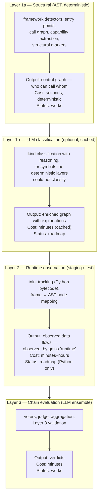
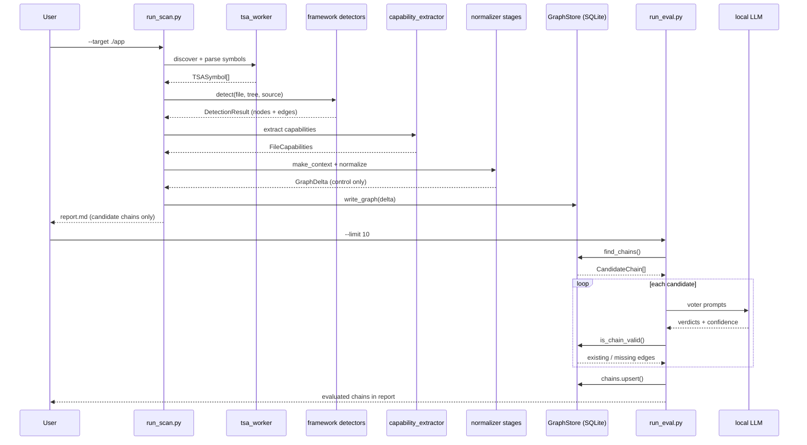

# AICorellator — Architecture Overview

**Audience:** developers. For the user-facing description, see `README.md`.

This document explains how the system is put together and why. It does
not replace the ADRs (which record *decisions*); it gives the shape
that the ADRs fill in.

---

## The four layers

AICorellator is a pipeline with four layers. Each layer has one job,
one cost profile, and one determinism guarantee.



**Layer 1a is control-only, by design.** It answers "who can call whom"
and nothing else. It does not attempt to answer "does data flow from X
to Y" — that is Layer 2's job, and the AST cannot do it (ADR-0016).
This is why `data_edges_only` returns `[]` on a Layer 1a scan: it is
the honest answer, not a failure.

**Layer 1b is opt-in.** It is invoked only for symbols the
deterministic layers could not classify (see
`scan.yaml: llm_classifier.mode`). On a project fully covered by
framework detectors and capability extraction, it is never called.

**Layer 2 is Python-only, for now.** Runtime analysis is
language-specific (`sys.settrace` for Python, eBPF for Go/Rust,
bytecode agents for Java). Adding a language means adding a runtime
module, not a runtime flag. Python is first because it is the target.

**Layer 3 is LLM-only for evaluation, deterministic for validation.**
The verdict comes from a voting ensemble; every reported edge is
checked against the graph. See ADR-0005 and ADR-0006.

---

## Two attributes, two questions

Every node and every edge carries two independent facts:

| Attribute | Question it answers | Values |
|---|---|---|
| `flow_kind` | What kind of flow is this? | `control` / `data` / `structural` |
| `observed_by` | Who says so? | JSON array: `["ast"]`, `["ast", "runtime"]`, ... |

They are orthogonal:

- `flow_kind = "control"` + `observed_by = ["ast"]` — "X calls Y,
  according to the AST". The default for every Layer 1a edge.
- `flow_kind = "data"` + `observed_by = ["ast", "runtime"]` — "data
  from X reaches Y, and we saw it happen". The strongest signal.
- `flow_kind = "data"` + `observed_by = ["runtime"]` — "we saw data
  flow, but the AST does not have this edge". A dynamically created
  path.
- `flow_kind = "structural"` + `observed_by = ["ast"]` — a declaration
  (`guards`). Not traversed by `find_chains`.

`data_flow_confirmed` (a third field, only on `has_access_to`) answers a
narrower question: *how* was data flow established — `parameter_match`,
`local_var_match`, `call_result_match`, `literal_only`, `no_args`,
`unknown`, or `NULL`. On a Layer 1a scan it is `NULL` everywhere: the
AST layer does not answer this question. It is populated by Layer 2.

`data_edges_only` filters on `"runtime" in observed_by`, not on
`flow_kind = "data"`. This is what makes the filter honest: it returns
chains where data flow was actually observed, not chains where an AST
heuristic guessed.

---

## Scan policy: `scan.yaml`

Which layers run, and how, is not a set of CLI flags. It is a file:
`config/scan.yaml`. Created from a template on first run (with a
warning), editable by the user, versionable in git.

```yaml
detectors:
  enabled: []                 # [] = all built-in detectors
  disabled: []
user_detectors: []            # paths to user FrameworkDetector subclasses

llm_classifier:
  mode: "auto"                # off | auto | required
  config: "config/llm_classifier.yaml"

runtime:
  mode: "off"                 # off | python
  test_command: null

unclassified:
  action: "ask"               # ask | skip | llm | error

logs:
  keep_archives: 5
```

CLI flags are minimal: `--target`, `--config`, `--clean`. Everything
else is policy, and policy is in the file. This is what makes a scan
reproducible: "we ran with this `scan.yaml`" is a fact; "we ran with
these flags" is not.

---

## Module layout

```mermaid
flowchart LR
    subgraph PARSING["parsing/ — analysis layer (AST, per-aspect)"]
        direction TB
        TSA["tsa_worker.py<br/>only multi-language component"]
        CAP["capability_extractor.py<br/>call-site capabilities"]
        EP["entry_points.py<br/>routes, CLI, Streamlit"]
        FD["framework_detectors/<br/>LangChain, LangGraph, FastMCP, MCP SDK"]
        FDL["framework_detectors/loader.py<br/>(new) user detectors from paths"]
        FLOW["flow/<br/>per-edge, per-node decisions"]
        LLMC["llm_classifier/<br/>(new) Layer 1b"]
        SC["scan_config.py<br/>(new) ScanConfig dataclass"]
    end

    subgraph GRAPH["graph/ — SQLite graph store"]
        direction TB
        SCHEMA["schema.sql<br/>nodes, edges, chains, ..."]
        MODELS["models.py<br/>Node, Edge, observed_by"]
        QUERY["query.py<br/>find_chains, validate"]
        REPOS["repositories/<br/>thin CRUD"]
    end

    subgraph ANALYSIS["analysis/ — Layer 3 LLM ensemble"]
        direction TB
        EVAL["evaluator.py"]
        VOTERS["voters.py, judge.py"]
        PROMPTS["prompts.py"]
        CFG["config_loader.py<br/>models.yaml"]
    end

    subgraph REPORTING["reporting/"]
        direction TB
        BUNDLE["bundle.py, markdown.py"]
    end

    subgraph RUNTIME["runtime/ — (new) Layer 2"]
        direction TB
        RTPY["python/<br/>sys.settrace, frame mapper, stitcher"]
    end

    subgraph INGEST["ingestion/ + workspace.py"]
        direction TB
        DISC["target, discovery, hashing"]
        WS["workspace.py<br/>aicorellator_data/ layout"]
    end

    INGEST --> PARSING
    PARSING --> GRAPH
    GRAPH --> ANALYSIS
    GRAPH --> REPORTING
    RUNTIME -.->|enriches| GRAPH
```



**Note on `parsing/`:** it is not `parsing/python/` + `parsing/go/`. It
is a flat set of analysis modules, because each module is "an aspect
of analysis", not "support for a language". Python `ast` inside
`capability_extractor` is an implementation detail of that module, not
a language layer. TSA is the only component that knows about multiple
languages. Runtime is the only layer where language is the primary
unit — and that is honest, because runtime analysis *is*
language-specific.

---

## Data flow between layers



Layer 1a (`run_scan.py`) writes control edges only. Layer 3
(`run_eval.py`) reads them, evaluates, and writes verdicts. Layer 2
(runtime) is not in this diagram yet — when it lands, it will write
`observed_by` additions to the same graph, between the two runs.

---

## What changed in ADR-0016

- `FlowKindStage` sets `flow_kind = "control"` on every AST edge and
  **does not read** `data_flow_confirmed`. The value stays `NULL` until
  Layer 2 populates it.
- `observed_by` is added to nodes and edges (JSON array, default
  `["ast"]`, required).
- `data_edges_only` filters on `"runtime" in observed_by`.
- `data_flow_confirmed = "unknown"` is no longer a value on Layer 1a
  edges. The Layer 1a value is `NULL` — "this layer does not answer".
- LLM classification is controlled by `scan.yaml`, not by a flag.
- The class-A name heuristics (`SINK_METHOD_NAMES`, `RUNNER_TO_AGENT`,
  `EXTRA_AGENT_CLASSES`, ...) are removed. Classification is
  capabilities + framework detectors + (optional) LLM.

See `ADR_016.md` for the full decision.

---

## Reading order for a new developer

1. `README.md` — what the project does, for users.
2. This file — the shape.
3. `Documentation/ADR/ADR_0001.md` … `ADR_0016.md` — the decisions, in
   order. Each is short.
4. `Documentation/Architecture/C4_L2_Containers.md` — the container
   view, if you need it.
5. `Documentation/BACKLOG.md` — what is not done, and why.